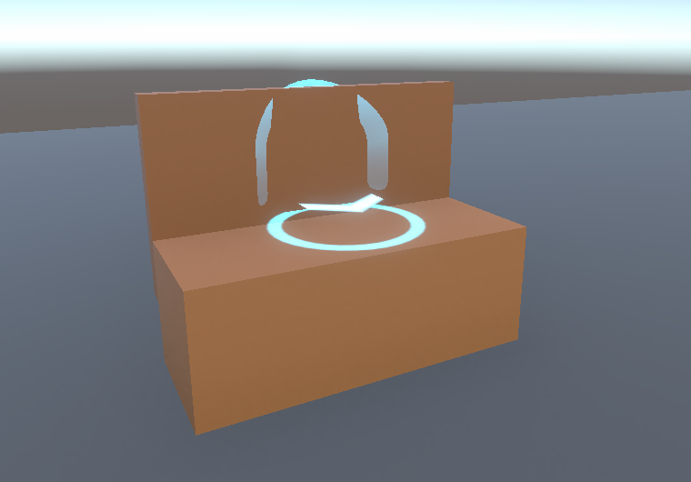

# Easy Prefabs

Ready-made objects for common space features, under `GameObject > BS` (also the Hierarchy's right-click menu). They ship with the Creator SDK package; there is nothing to import.

- **Player**: Spawn Point, Spawn Range, Seat, Teleporter, Scene Settings.
- **Grab**: one preset per grab type (Point, Point as a gun, Cylinder, Ball, Soft) and a climbable handhold.
- **Objects**: Mirror, Avatar Mirror, Photo Wall, Browser, Video Player, Text, Audio Source, Portal, GLTF Model, Synced Object, UI Panel, Billboard, Collider Events, Verify Host, Verify Group.

New objects land where Unity's own `GameObject` menu puts them: under the object you right-clicked, otherwise at the Scene view's centre (or the world origin, if **Preferences > Scene View > Create Objects at Origin** is on).

The mirror, browser, UI panel, portal, text and glTF model only build their visuals in Play mode, so the Scene view outlines them in blue instead, whether they came from this menu or **Add Component**: their size, and an arrow on the side they're seen from. The mirror, browser, UI panel and text all face the object's back (−Z), the opposite of the blue axis; a glTF model faces the blue axis (unless **Legacy Rotate** is on); the portal turns to face the player. Text also shows what it says. Select one to see its size in metres.

The player prefabs are built on SDK components (`BSSpawn`, `BSSeat`, `BSTeleporter`, `BSSettings`).

## Spawn Point and Spawn Range (`BSSpawn`)

When the space loads, one of the scene's active spawns is picked at random, and the local player is teleported there. The teleport uses the spawn's position and its Y rotation as the player's facing. `radius` spreads arrivals: players land at a random point within that many metres, on the horizontal plane. Spawn Point has radius 0 and Spawn Range has radius 5; otherwise they are the same component. For several spawn locations, add several spawns.

The teleport stops the player's velocity. A spawn added by a page script after the space has loaded doesn't move anyone. Scripts can call `Spawn()` on any spawn to send the local player there.

## Seat (`BSSeat`)

Clicking the seat sits the local player on it. Moving (the move stick or WASD) or jumping stands them up, unless `unseatOnMove` / `unseatOnJump` are off.

The prefab is one GameObject: `BSSeat`, `BSAttachedObject`, `BSObjectId`, `BSPointerRange` and a trigger BoxCollider on the **UI layer**. Its origin is the sitting point, facing local **+Z**; place it at the top of your furniture's cushion. It has no solid collider or furniture mesh; keep physical collision on your actual furniture.

Select the seat to see a reference robot sitting on it, then pose it with **Edit Pose in Scene**. The [Seats](seats.md) page has the whole of it:

- [The Scene view gizmos](seats.md#the-seat-in-the-scene-view) and how to use each one: the marker, the robot, the pose points and the exit point.
- [Posing the sitter](seats.md#pose-the-sitter): feet on the floor, presets and seated animations.
- [View Rotation](seats.md#view-rotation): whether the player tips over with the seat or stays upright.
- [Vehicles](seats.md#vehicles): several seats on one car, boat or plane.
- [Troubleshooting](seats.md#troubleshooting).

For scripts and graphs, see [Seat API](../components/player-setup.md#seat).

## Teleporter (`BSTeleporter`)

When the local player walks into the trigger collider, they land at the configured destination and face its Y rotation. **Stop Velocity** stops their movement; **Cooldown** (0.5 s) prevents an immediate repeat. Only colliders tagged `BSLocalCharacter` count; don't give that tag to anything else.

The prefab has its trigger, portal mesh, renderer and `BSTeleporter` on the root, with one `Destination` child retained for compatibility. Set the landing position and facing directly in the BS Teleporter Inspector, or move and rotate that child. Select the teleporter to see the curved route and exit-facing arrow. Keep the landing point outside the trigger. The portal stays aligned with its root; no Animator or camera-facing helper turns it.

An assigned **Override** transform takes precedence over the direct local position and yaw. At runtime, `Destination` can point to another transform; `DestinationPosition` and `DestinationYaw` configure the local fallback when no transform is assigned. **Use Local Destination** (`UseDestinationPosition`) enables that fallback; an older component with no destination stays invalid until configured.

The portal defaults to a cached image looking out from the destination at player eye height, in the editor and during play. It refreshes when the destination changes; use **Refresh Destination Image** after changing scenery at an unchanged destination. In VR, it caches two views in one stereo atlas using the headset eye spacing; each eye samples its own view. Desktop and editor use one image. The default is 256 pixels per eye. Cached images have a fixed viewpoint and do not update moving scenery or head-motion parallax.

Enable **Realtime When Nearby** for a live perspective view while the player is close and the portal is in the camera frustum. It maps the actual viewer and stereo eye cameras through the entrance to the destination, clips geometry in front of the exit plane, and keeps the existing glow. This follows the coordinate mapping used by the 3D mirror, with separate portal images and properties so multiple portals cannot overwrite each other. Leaving range returns to the cached view; approaching again refreshes immediately. Live capture runs just before the main camera renders, after URP refreshes its stereo eye matrices. Portal-in-portal recursion is suppressed.

Expand **Advanced** to adjust per-eye resolution (64–1024), live distance (default 8 m), and live refresh rate (0 means every frame). Lower resolution reduces rendering cost; a refresh cap reduces work but makes head-motion updates less smooth in VR. Live rendering is opt-in and renders the destination again for each eye. Single-pass VR captures both eyes once per frame; multipass updates the active eye, with a both-eyes-per-pass fallback if Unity cannot identify the active eye. Device performance and headset comfort need checking in the target world.

**Show Runtime Visual** defaults to on. Turning it off hides the full portal mesh and releases its captured image without disabling the teleport trigger. Editor destination images and the selected route remain available. Temporary capture data and the live capture camera are released when no longer needed or when the component is disabled.

## Scene Settings (`BSSettings`)

Sets the space's settings from the scene:

- abilities: teleport, force grab (distance grab), spider-man, bird flight, running, hand holding, radar, name tags, portals, guests. Distance grab, bird flight and running are on unless you turn them off here
- the furthest players can teleport (Teleport Max Range, in metres; 0 leaves it to each player), and whether players may stream their menu browser into the space (on unless you turn it off)
- the megaphone: whether anyone can turn their own on (off unless you turn it on), how far megaphones and walkie-talkies carry (Megaphone Distance Multiplier; 0 follows the voice distance), and a lock that keeps it to moderators until the player leaves
- the fall safety net: on unless you turn it off, and the height it catches falling players below (Safety Net Height, -250 unless you change it)
- refresh rate and clipping planes
- player physics
- the locks (settings, physics, megaphone)

They are applied when the space loads, again when the page reloads, and whenever a property changes. Spawn point, occupancy, avatars and dev tools are not included. Use one per scene.

A page script that calls `scene.SetSettings(...)` sends every setting, so it replaces these if it runs afterwards. Either remove that call, or tick both locks so nothing can change the settings later. The build checklist warns when a page calls `SetSettings` and the settings aren't locked. In SDK Play Mode only the clipping planes have a visible effect; everything else takes effect in the client.

## Grab presets

Each grab preset is a Rigidbody root with `BSWorldObject` and `BSSyncedObject`, so every player sees it move, plus a collider on the **Grabbable layer (20)** with a `BSGrabHandle` saying how it's held:

| Preset | Grab type | How the hand holds it |
|---|---|---|
| Point (Handle) | Point | Snaps to one pose: the `GrabHandle` transform (a trigger capsule around the grip). |
| Point (Gun) | Point | The same grip, plus `BSHeldEvents` with the triggers blocked, so the trigger fires the gun's events. |
| Cylinder (Stick) | Cylinder | Anywhere along the handle's Y axis. |
| Ball | Ball | Anywhere on a sphere of the grab radius. |
| Soft (Any Shape) | Soft | Wherever the hand touches the collider. |
| Climbable Handhold | Cylinder | No Rigidbody, so grabbing it holds on to the world. |

Replace the placeholder meshes with your own and keep the handle collider on the Grabbable layer. `BSGrababble` (see [VR Interaction](../components/vr-interaction.md#grababble)) is the all-in-one alternative: it adds the grab handle, `BSWorldObject` and held events itself and moves the object to the Grabbable layer, whether you add it in the Inspector or from a script.

Select a grab preset, `BSGrabHandle` or `BSGrababble` with **Gizmos** enabled to see a glowing hand in the Scene view. The two grab inspectors have an **Editor hand preview** toggle and an **Editor preview hand** selector; a handle restricted to one hand previews that hand. Selecting a parent prop also previews its child handles. The manual hand selector is for editing only and is hidden in Play Mode; runtime holograms automatically use the nearby tracked left or right hand. The SDK desktop simulator uses its simulated right hand.

- **Point** shows the fixed grip, including its facing and the left/right palm offset.
- **Cylinder** shows a grip around the handle's local Y axis. Drag the approach dot to try another side or height.
- **Ball** places the palm on the grab-radius sphere. Drag the approach dot to try another side.
- **Soft** uses the collider's surface instead of the grab radius. Drag the approach dot to choose where the hand reaches it.

The preview calls the runtime grab solver on isolated editor copies; moving the approach dot does not move your handle or change its serialized data. To change the actual grip, edit the handle's transform, grab type or radius. Finger curl is representative: avatar proportions, trigger input and custom hand poses can differ. Existing runtime limitations, including non-convex Soft sampling and Cylinder orientation under nested rotated parents, are also reflected in the preview.

Keep the Rigidbody root at unit scale for surface grips, and scale the collider/visual children instead. The current runtime surface solver can offset joint anchors when the Rigidbody itself is scaled; the preview preserves that behaviour and the inspector warns about it.

The editor and client share the stylized rig at `Runtime/Resources/CreatorConveniences/Models/GripHand.fbx`, copied from this project's authored hand. Position and rotation always come from the actual grab handle solver. Fingers curl against that handle's collider; a hand whose trigger is reserved by held events keeps its index finger extended. The thumb preserves its authored opposition and uses smaller bend limits than the other fingers. The left hand mirrors the right-hand rig. Each local preview owns one hidden rig with its renderer disabled and one reusable fitted mesh. New targets fit immediately; approach/shape changes refit at most 20 times per second. No continuous GPU skinning or preset pose assets are required. Finger fitting is a visual approximation: actual Flexabody fingers follow controller grip/trigger/touch poses or hand tracking, with optional custom handle poses; the ghost does not change those animations.

The complete hand is transparent, using the shared `Materials/GripHologram` material with the seat's cyan HDR color, a restrained rim glow and gentle traveling highlight. The authored second UV channel drives the wrist-to-fingertip gradient; UV0 is preserved. A shared `GripHologramDepth` material first records the nearest hand surface after ordinary world transparency renders; the color draw blends only where depth matches. This keeps the background visible without brightening through overlapping fingers/back faces. Both draws reuse the same fitted mesh and shader, with no texture, bloom feature or renderer feature required. Fade changes alpha smoothly. Custom transparent effects queued after 3100 can be masked by the hand's depth. Finger fitting uses native surface queries for primitive/convex colliders and conservative bounds for concave colliders.

Both materials share URP's instance/eye transfer path for single-pass instancing and multiview. Automated shader compilation covers PC D3D and Android Vulkan/OpenGL ES stereo variants for both the hand and seat. These compiler checks do not replace a two-eye headset test or device profiling.

**Show Runtime Visual** on `BSGrabHandle` or `BSGrababble` controls the in-game hand hologram for that object and defaults to on. If both components are present, either switch can hide the hint. Editor hand previews and actual grabbing are independent of this setting.

In the client, each local hand shows the pose of its actual next grab candidate inside the configured grab range. The indicator fades on leaving range and hides while holding, when grabbing is blocked, or when the local rig is disabled. It uses the same candidate picker as grabbing, including its existing first-overlap priority. The SDK desktop simulator shows the same hologram at the winning grabbable under the cursor; nearer UI/click targets, flying and holding suppress it. Hover and grabbing share the same mouse-hand approach calculation.

Holograms are local visuals with one state per hand, cached meshes/material and per-hand opacity; no network messages, per-grip renderers or authored scene objects are added. The hidden fitting rigs belong to the local previews and are disposed with them. A bare Grabbable-layer collider without a configured runtime grab handle keeps the existing Soft-grab fallback but has no hint until a handle exists. Add `BSGrabHandle` or `BSGrababble` for the complete authoring/preview flow.

## Objects

Each object is one SDK component, set up for the usual case:

| Object | What you get |
|---|---|
| Mirror | `BSMirror`: a 2.5 × 2.5 m mirror, seen from the object's back (−Z). |
| Avatar Mirror | `BSAvatarMirror` on an empty object on the floor: a still copy of the player's avatar that mirrors their movements and faces them; see [Avatar Mirror](#avatar-mirror-bsavatarmirror). |
| Photo Wall | `BSPhotoWall` on one object, its middle 1.5 m up: a 2 × 1.2 m corkboard players pin their photos to; see [Photo Wall](#photo-wall-bsphotowall). |
| Browser | `BSBrowser` showing `https://sidequestvr.com`; see [Browser](#browser-bsbrowser). |
| Video Player | A 1.6 × 0.9 m quad with `BSVideoPlayer`; the video plays on it. |
| Text | `BSText` saying "Hello World" at font size 2, wrapping inside a 20 × 5 m area, read from −Z. |
| Audio Source | `BSAudioSource` with Spatial Blend 1, so it's heard from where it is. |
| Portal | `BSPortal`, a doorway to another space; see [Portal](#portal-bsportal). |
| GLTF Model | `BSGLTF` with Add Colliders on. Set its `url`; the model loads in Play mode, facing +Z. |
| Synced Object | A 0.3 m cube with a Rigidbody and `BSSyncedObject`, so every player sees it move. |
| Spawner Object | A 0.4 m stick on the Grabbable layer with a kinematic Rigidbody, `BSWorldObject`, `BSSyncedObject`, `BSGrababble` (a Cylinder grip along its length) and `BSSpawnerObject`. Grabbing it puts a synced copy of the stick in your hand while the stick stays put; see [SpawnerObject](../components/special.md#spawnerobject). |
| UI Panel | `BSUIPanel`: 512 × 512 pixels at 100 pixels per metre, so 5.12 m square, read from −Z. |
| Billboard | A quad with `BSBillboard`, which turns it to face the player. |
| Collider Events | A 2 m trigger box standing on the object, with `BSColliderEvents` reporting enter and exit to the page and Visual Scripting. |
| Verify Host | `BSVerifyHost` on an empty object, checking the world is running from its own address. Set its **Url** and choose what happens at any other address; see [VerifyHost](../components/special.md#verifyhost). |
| Verify Group | `BSVerifyGroup` on an empty object, checking the player is a member of a SideQuest group. Set its **Group Id** and choose what happens to anyone else; see [VerifyGroup](../components/special.md#verifygroup). |

### Avatar Mirror (`BSAvatarMirror`)

A mirror image of the player as a real copy of their avatar, not a camera picture. The copy stands still on this object and mirrors the player's movements like a reflection: head, arms, hands, fingers, face, jiggle bones, every worn item and colour, and their exact height, so crouching and jumping come through. It always faces the player it mirrors. Walking around doesn't move it. Players in VR can always fist bump and high five it, and hold hands with it (palm on its palm, then grip).

It is one object with no meshes: put it on the floor the players stand on. While it is selected, the Seat's hologram robot stands on it in the Scene view, and a ring on the floor shows the Load Distance. A player within that distance is mirrored: the copy appears with a shimmer, growing up from the floor, and shrinks back into it when they walk away.

- **Shared**: off (default): everyone near sees their own copy, on their own screen only, so any number of people can use it at once. On: one person at a time is mirrored, and everyone near sees that copy; the next person can step up once they leave.
- **Height Offset**: raises (or, negative, lowers) the copy, in metres.
- **Load Distance**: how close a player must be to be mirrored (default 3 m, across the floor, on the same floor). The copy is only loaded for viewers that close.
- Turn the component off to switch the mirror off. Scripts can add it too: `await gameObject.AddComponent(new BS.AvatarMirror(false, 0, 3))`.

Shared mirrors are told apart by the object's `BSObjectId`, so there is nothing to set. Copies only appear in the client, not in SDK Play Mode, and at most two are drawn at once (the nearest).

### Photo Wall (`BSPhotoWall`)

A wall players pin their photos to. In the Scene view it shows filled with placeholder photos in its real layout, frames
and shape, and the selected wall says how many photos it holds, so you see the result without pressing Play. It faces
the way the mirror does: photos are seen from the object's back (−Z), the opposite of the blue axis.

- **Layout**: Grid (tidy rows), Corkboard (each photo a little off its place and tilted, as if pinned by hand) or
  Strings (polaroids hung on strings that dip in the middle). One row of a grid is a gallery row.
- **Rows** and **Columns**: how many photos, row by row; rows × columns is at most 35.
- **Photo Size**: how wide each photo is, in metres (its frame adds to it). The wall's size follows from the rows,
  columns and photo size; its middle is the object.
- **Frame**: Layout Default (polaroids on the corkboard and strings, a border otherwise), None, Border or Polaroid.
- **Shape**: Layout Default, Rectangle, Rounded or Circle (a round photo shows the middle of the picture).
- **Frame Colour**, **Show Board** and **Board Colour**: the photo paper, and the board behind the photos (off: they
  hang on whatever is behind the wall).
- **Replace Oldest**: on a full wall, the oldest photo makes room for a new one. Off: it stays full until photos are
  taken down.
- **Admins Only**: only the world's admins can pin photos, for a hall of fame. Off: anyone signed in.

Each wall gets its own tilt pattern from its `BSObjectId`, the same for every player. Photos are drawn small into one
texture per wall, so a full wall is a single draw. Scripts can add a wall and set its rows, columns, photo size,
Replace Oldest and Admins Only: `await gameObject.AddComponent(new BS.PhotoWall(3, 6, 0.24, true, false))`;
the layout and look are set in the inspector. A wall made by a script is known by its object's id, which differs from
player to player until the object has a network id: give it one (`SetNetworkId`) so everyone sees the same wall. Photos
only appear in the client, not in SDK Play Mode.

### Browser (`BSBrowser`)

Shows a web page in the space. Set `url` to your page. The page is `pageWidth` × `pageHeight` pixels (1280 × 720) and is drawn at 1300 pixels per metre, so about 0.98 × 0.55 m, centred on the object and read from its back (−Z). Change the page size to resize it, or scale the object; **Pixels Per Unit** doesn't change it. The page loads in Play mode; until then the blue outline shows where it will be. Clicks and scrolling reach the page. For messages, textures and everything else browsers can do, see the [Browser](../browser/overview.md) section.

### Portal (`BSPortal`)

A doorway to another space: set `url` to that space's address. In Play mode the portal looks the space up and shows its name and icon (a placeholder landscape if it has no icon, and "Unknown Space" if the address isn't a space). When the local player walks into it, the client takes them there. In SDK Play Mode you stay in your world: the Console says where the portal would go.

The ring is about 2.15 m across, 0.8 m above the object, and turns about its vertical axis to face the player, so the object's rotation doesn't matter; the blue outline in the Scene view turns towards the camera the same way.
