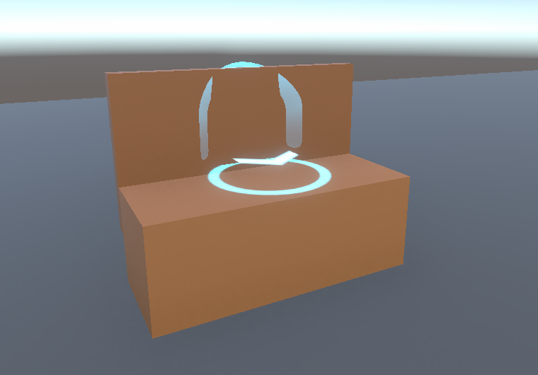
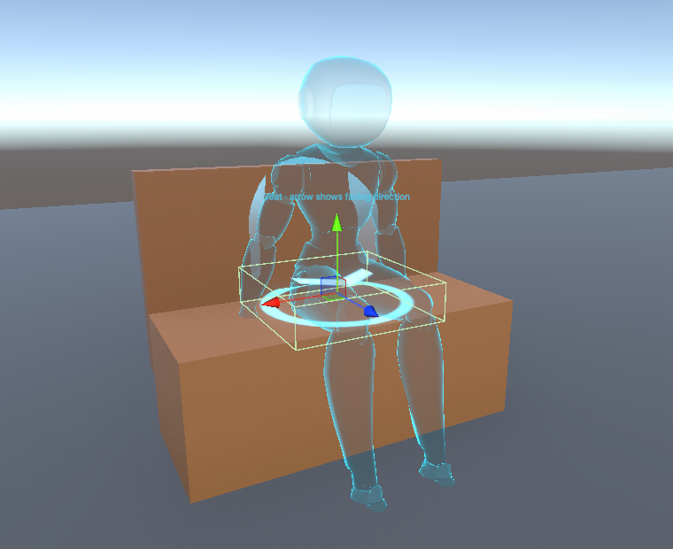
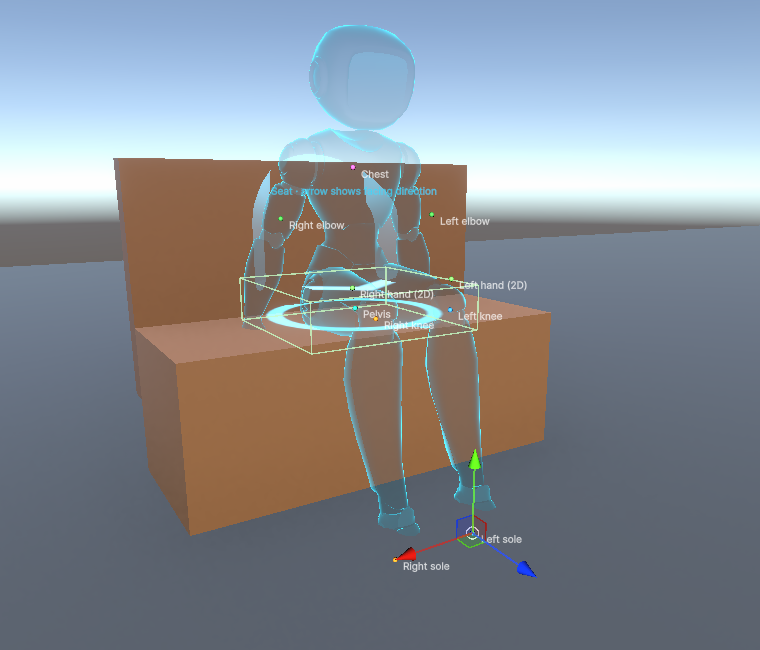
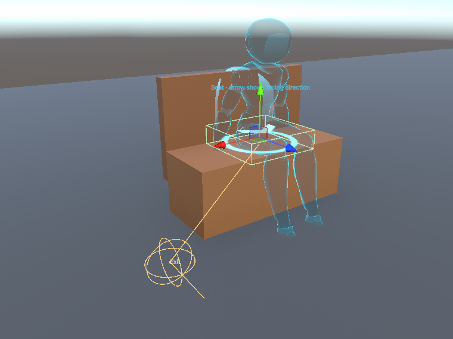
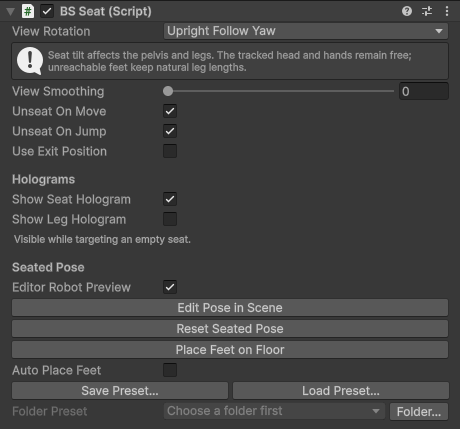
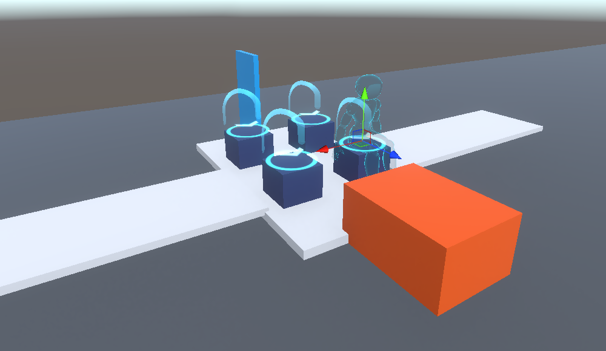

# Seats

A seat is a point in your world a player can click to sit on: a chair, a bench, the driver's seat of a car, a row in a plane. The player's hips are held on the seat in a pose you author, their legs are placed for them, and their head and hands stay free. When the seat moves, the player moves with it.

This page covers adding a seat, the Scene view gizmos and how to use each one, posing the sitter, how the view behaves, and vehicles with several seats. For scripts and graphs, see the [Seat API](../components/player-setup.md#seat).

## Add a seat

1. Choose `GameObject > BS > Player > Seat` (also in the Hierarchy's right-click menu).
2. Move it so its origin is on **top of the cushion**. The origin is the sitting point.
3. Turn it so the arrow points the way the sitter should face. That is the seat's local **+Z**.

The preset starts 0.48 m above the point it was placed at, about the height of a chair.

The prefab is one GameObject:

| Part | What it is for |
|---|---|
| **BS Seat** | The seat itself: the settings on this page. |
| **BS Attached Object** | Attaches the player to the object. BS Seat sets it up as a seat for you (Physics + AvatarAttachTo, jointed, `isSeat`, never auto-attached). |
| **BS Pointer Range** | How far away the seat can be clicked from. 2 m by default. |
| Trigger **Box Collider** | What gets clicked. It is on the **UI** layer: only the UI and Menu layers can be clicked, in the app and in Play mode. |
| **Unique Object Id** | The seat's identity for scripts and for other players. |

The prefab has no solid collider and no furniture mesh. Keep physical collision on your actual furniture.

Three things to know when you build a seat yourself:

- The seat listens for clicks on the colliders it has **when it starts**, on its own object or its children. From a script, add the collider before the seat.
- A seat with no Rigidbody on itself or any parent adds a kinematic one, so the chair stays where you put it. A seat under a vehicle's Rigidbody uses the vehicle's.
- When updating older prefab instances: the sitting origin moved from the `SitPoint` child onto the root. Check placement and transform overrides so the root stays at cushion height. Keep the existing Unique Object Id; do not regenerate it to migrate a seat.

## The seat in the Scene view

Everything below needs the Scene view's **Gizmos** toggle on. None of it appears in the Game view while you edit.

### Seat marker

The picture at the top of this page shows a seat that is not selected. Every seat draws its marker all the time:

- **Ring**: the sitting point. Its centre is the seat's origin.
- **Arch**: the backrest side. The sitter's back is towards it.
- **Arrow**: the way the sitter faces.

The marker follows hidden objects and Prefab Mode: hide the seat and its marker goes too.

### Robot preview

Select a seat and a see-through robot sits on it in the seat's saved pose, wearing the Basic shoes so you can judge where the feet land. This is the **Editor Robot Preview** toggle in the Inspector, on by default.

The gizmo in this picture is Unity's own Move tool: it moves the seat, and the robot comes with it. The yellow box is the seat's click collider.

The robot is a reference body, not the player's avatar. In the app each avatar keeps its own limb lengths, so a much taller or shorter avatar sits a little differently (see [What the pose stores](#what-the-pose-stores)).

If the robot does not show, check that the seat is selected, active and not hidden, that Gizmos are on and **BS Seat** is ticked in the Gizmos menu, that the seat's layer is visible, and that **Editor Robot Preview** is on. It never shows in Play mode.

### Pose points

Click **Edit Pose in Scene** in the Inspector. The robot gets a labelled point on each part you can place:

Clicking a point only selects it: it gets a white ring and the gizmo. Then:

- **W** (Move) drags the selected point.
- **E** (Rotate) turns it, for the points that can turn.
- Unity's **Local / Global** toggle sets which way the Move gizmo's arrows point.
- Hold **Alt** to orbit the camera without selecting a point by accident.

| Point | Colour | Move (W) | Rotate (E) |
|---|---|---|---|
| **Pelvis** | Teal | Where the hips sit. The feet stay planted. | Tilts and turns the hips. |
| **Left sole**, **Right sole** | Blue, orange | Where the bottom of each foot rests. | Turns the foot. |
| **Left knee**, **Right knee** | Blue, orange | Places the knee. The foot stays where it is while the leg can reach, and follows once it cannot. Leg lengths never change. A knee above the hip never goes behind it. | No |
| **Chest** | Pink | Leans the upper body: the back points from the pelvis towards this point. Unset, the torso stays upright whatever the pelvis tilt. | No |
| **Left hand (2D)**, **Right hand (2D)** | Light green | Where a desktop or mobile player's hand rests. In VR the hands always follow the controllers. | Turns the hand. |
| **Left elbow**, **Right elbow** | Green | Which way that elbow points. | No |

While you edit the pose, Unity's tool for the seat object itself is hidden so you cannot move the seat by accident. Click **Finish Editing Pose** to get it back.

Once a hand or elbow has been placed, a **Clear Hands** button appears: it puts desktop players' hands back to their usual rest.

Every edit supports Undo and prefab overrides. A prefab asset selected in the Project window cannot be posed; open it in Prefab Mode. Posing is off in Play mode.

### Exit point

Turn on **Use Exit Position** and select the seat. An orange **Exit** point appears, with a line back to the seat:

- **Drag the orange point** to where the player's feet should be when they get off. It moves in the plane of the view, so place it from above first and then check it from the side, or type the numbers into **Exit Position** in the Inspector.
- The wire ball is 0.3 m across, to show the spot. The short line out of it shows the seat's facing.
- You do not need to be editing the pose. It works in every View Rotation mode and supports Undo and prefab overrides.

The exit is stored relative to the seat, including the seat's scale, so it moves with the seat. See [Sitting down and getting off](#sitting-down-and-getting-off) for what happens with it off.

## Inspector settings

| Setting | Default | What it does |
|---|---|---|
| **View Rotation** | Upright Follow Yaw | How the seat carries the player's view. See [View Rotation](#view-rotation). |
| **View Smoothing** | 0 | Seconds the view takes to catch up with the seat's rotation. Not shown for Upright Independent. See [View Smoothing](#view-smoothing). |
| **Unseat On Move** | On | Pushing the move stick (WASD on desktop) stands the player up. |
| **Unseat On Jump** | On | Jumping stands the player up. |
| **Use Exit Position** | Off | Put the player at the [exit point](#exit-point) when they get off. |
| **Show Seat Hologram** | On | During play, show the marker and the sit hint to a player aiming at this empty seat. `ShowRuntimeVisual` in C#. |
| **Show Leg Hologram** | Off | During play, also show the posed robot pelvis, legs and shoes to that player. |
| **Editor Robot Preview** | On | The robot in the Scene view. Editor only. |
| **Edit Pose in Scene** | | Shows the [pose points](#pose-points). |
| **Reset Seated Pose** | | Replaces the whole pose with the default. |
| **Place Feet on Floor** | | Drops both soles onto the colliders below them. See [Feet on the floor](#feet-on-the-floor). |
| **Auto Place Feet** | Off | Re-drops the feet whenever you move the seat in the editor. |
| **Save Preset…**, **Load Preset…**, **Folder Preset** | | Pose files. See [Presets](#presets). |

The two holograms are independent: either, both or neither. They show only while the local player targets an empty seat within range, and hide when it is occupied. They are visual aids. Hiding them does not disable the collider, sitting, or the editor preview. The hint reads **Trigger to sit** in VR and **Click to sit** on desktop.

## Pose the sitter

1. Select the seat and click **Edit Pose in Scene**.
2. Click **Pelvis** and move it until the robot's underside rests on the cushion.
3. Click each **sole** and put it on the floor or footrest, or use **Place Feet on Floor**.
4. If a knee bends the wrong way or pokes through something, drag the **knee** point.
5. For a reclined seat, drag **Chest** back to lean the upper body.
6. Click **Finish Editing Pose**.

Set the pose before the seat is used. The pose is read when a player sits, so a change made while someone is seated applies the next time they sit.

### Feet on the floor

**Place Feet on Floor** drops each sole straight down onto the first collider below it, measured for the preview robot's legs.

- Any collider counts as floor, including the chair's own footrest. Triggers and the Ignore Raycast layer are skipped.
- A foot that had sunk below the floor is lifted back onto it.
- If the floor is further than the leg can reach, the foot is left at full reach above it and the Inspector says by how many centimetres. If there is no collider within range below a foot, that foot is left alone and the Inspector says so.
- On a sloped floor the sole tilts to match, up to a limit.

**Auto Place Feet** does the same automatically whenever you move, turn or re-parent the seat in the editor, as part of the same Undo step. It is an editing aid only: in Play mode and in the app the saved pose is used as it is.

### Presets

- **Save Preset…** writes the pose to a `.seatpose.json` file.
- **Load Preset…** replaces the seat's pose from one, with Undo. Damaged, incomplete, wrong-kind or newer-version files are refused without changing the pose.
- **Folder…** picks a preset folder for this project. **Folder Preset** then lists the seat presets in it, and choosing one loads it.

A preset is relative to the seat, so check foot height after loading one onto different furniture.

### Seated animation

A seat can play a looping animation on its sitter instead of holding one still pose: legs swinging on a wall, feet pedalling a bike.

1. Click **Load Preset…** and set the file filter to **Animation** (or **All files**).
2. Pick a humanoid `.anim` file, or a model file with a humanoid take, from inside the project (Assets or Packages). A clip that is not humanoid is refused: set its model's Rig to **Humanoid**.

The clip is baked into the seat at 15 frames a second. The clip file itself is not referenced or shipped with your world. A **Seated Animation** section appears in the Inspector with the clip, the loop length, **Re-bake** and **Remove Animation**.

- The pelvis stays where the seat pose puts it, so the player's view does not move. The pelvis tilt, chest, feet, knees, hands and elbows follow the clip.
- The hands apply to desktop and mobile players. VR hands follow the controllers.
- The robot preview plays the loop. With **Edit Pose in Scene** on, drag **Pelvis** to move the whole animation, **Chest** to lean it, and the feet, knees, hands and elbows to nudge them. **E** turns a sole or a hand.
- **Re-bake** with the same clip keeps your nudges. Picking another clip, or **Remove Animation**, clears them.
- The animation plays on the sitter's own client and other players see it through the normal avatar pose. It is authored in Unity only; it is not a JavaScript property.

### What the pose stores

The pose stores the pelvis and both soles (position and rotation), two knee points, and the optional chest, hand and elbow points.

- **Defaults:** the pelvis joint is 0.04 m above the seat origin, which puts the reference robot's underside just above the seat plane. The soles are 0.60 m below and 0.475 m forward of the origin, giving nearly level thighs and naturally bent knees.
- **Metres, not scale:** the offsets are metres in the seat's rotated frame. A 0.2 m pelvis offset stays 0.2 m if the furniture or its parent is scaled.
- **Any avatar:** in the app the avatar keeps its own limb lengths, and targets outside its reach are clamped. A very short avatar, a large lean or an upside-down chair can leave the feet or the drawn head short of their targets. The camera stays tracked, and reaching a limit never ejects the player.
- **Existing poses are kept.** Only **Reset Seated Pose** replaces a pose with the defaults.

## Sitting down and getting off

- **Sit:** click the seat (trigger in VR). The player's viewing direction is lined up with the seat's forward. The upright modes line up the heading only and keep the head's real pitch and roll.
- **Reach:** the seat's **Pointer Range** is 2 m by default; change its **Distance** to change the reach. It governs clicking, the hover marker, the sit hint and the VR targeting ray. Distance is measured from the player's head to the seat's origin, so a scaled visual or a bigger trigger does not extend it. Leaving range before releasing the click cancels the sit. Editor previews and a scripted `Sit()` work at any distance.
- **Stand:** moving (the stick, or WASD) or jumping stands the player up, unless **Unseat On Move** or **Unseat On Jump** is off. Turn both off for a ride the player should not fall out of, and give them another way off, such as a button that calls `Stand()`.
- **Change seats:** clicking another seat moves the player straight to it. The first seat's exit position is skipped.
- **Getting off with Use Exit Position on:** the player's feet go to the exit point. Follow Seat faces them the way the seat faces; the upright modes keep the direction they were looking.
- **Getting off with it off:** the player is lifted 1 m above the seat with their speed cleared, and drops back down. Letting them go exactly where they sat could fling them.
- If something else has already moved the player more than 3 m from the seat (a portal, a respawn, a teleport), the exit is skipped so it does not undo that.

Moving or turning the seat itself always carries its occupant. View Rotation and the pose are read at the moment of sitting, so changing them while the seat is occupied takes effect after the player stands and sits again.

## View Rotation

**View Rotation** decides how much of the seat's turning reaches the player's view. In all three modes the pelvis and legs hold the authored pose and follow the seat's complete rotation; what changes is the view and upper body.

| Mode | The view | Use it for |
|---|---|---|
| **Follow Seat** | Carries the seat's full rotation. Tip the seat over and the player tips over with it, upside down included. | Planes, roller coasters, anything that banks, loops or rolls. |
| **Upright Follow Yaw** (default) | Follows the seat's position and its left/right turning. Pitch and roll are kept out of the view. | Chairs, sofas, cars, boats: the player turns with the vehicle and stays level. |
| **Upright Independent** | Follows the seat's position only. The seat's rotation never turns the view. | Seats that spin or sway while the player keeps their own heading: a swivel chair, a carousel. |

What stays the same in every mode:

- Real head movement and leaning work normally. The camera is never forced level when the player physically tilts their head.
- The upper body follows the tracked head and hands. Waist and foot trackers do not override the seat's pelvis and legs until the player stands.
- Desktop mouse look and gamepad look stay available.

In the two upright modes:

- Up is world **+Y**, or the direction against gravity for players who have Comfort > Gravity Tilting on.
- Snap turning and smooth turning in VR are off while seated.

### View Smoothing

**View Smoothing** (Follow Seat and Upright Follow Yaw) is how many seconds the view takes to catch up with the seat's rotation. It softens jitter and sharp turns on vehicles. 0, the default, follows exactly; the most is 1 second.

- Only rotation is smoothed, never position. At higher values the cabin swings a little around the player as the vehicle turns.
- It makes the view lag on purpose. It does not fix a rider who appears off their seat; see [Vehicles](#vehicles) for that.
- It is read when the player sits and needs a client that has the setting. It is set in the Unity Inspector only, and the SDK's desktop Play mode ignores it.

## Vehicles

Put the seats under one object that has the Rigidbody and the [BS Synced Object](../multiplayer/overview.md#synced-objects): a car, a boat, a plane. The seats need nothing of their own: no Rigidbody, and each click collider can be on the seat or on a child of it.

The first player to sit drives the vehicle (they become its owner). Everyone who sits after rides as a passenger. If one seat is the driver's, make its click call `TakeOwnership()` on the vehicle: that player then drives it whoever sat first. Every player keeps every rider on their seat on their own copy of the vehicle, so riders stay with the vehicle and with each other at any speed, upside down included.

- **A vehicle that tilts or flips:** set its seats to **Follow Seat**, so each rider's view and whole body turn over with it. The default keeps the head upright, which is right for a car and wrong for a loop.
- **Move it in Update or FixedUpdate.** Physics, a kinematic Rigidbody with `MovePosition`, an animation, a script's `SetTransform` and a Visual Scripting **On Update** all carry their riders in the same frame. A vehicle moved in **Late Update** is seen a moment late by the player driving it: they sit well behind their seat at speed.
- **Do not teleport it with riders aboard.** Passengers are carried across a jump, but the driver's own body is thrown by it, and they can be put back on the ground off the seat. Stand the driver up first (their own `seat.Stand()`), or fly the vehicle there.
- **Move a fast vehicle with physics.** Hands are physical bodies. On a vehicle moved by physics (velocity, forces, or `MovePosition` in FixedUpdate) every rider's hands stay with them at any speed, driver and passengers alike. On a vehicle a script moves by its transform, passengers are fine but the driver's own hands shake: 10 to 20 cm at 100 to 300 m/s on desktop, in bursts up to an arm's length on a Quest.
- **Give a seat inside a cabin an exit point outside it, or on the vehicle's own deck.** A seated player does not collide with their own vehicle, and after getting off the two collide again only once the player's body is clear of the vehicle's colliders. An exit point on a deck works when it is at the deck's surface (up to about 15 cm under it still lands the player on it). With no exit point under a roof, or an exit point inside a solid part of the vehicle, the player passes through the vehicle until they have walked out of it.
- **A seat can move inside its vehicle.** Animate the seat or move its transform (a cabin lift, a seat that slides back): the rider's view, body and hands go with it.
- **Turn Take Ownership On Collision off on the vehicle.** With it on, a player who touches a vehicle someone is riding, or stands on it, takes it over for as long as they touch it (that is how a swing gets pushed). With it off, the vehicle stays with its driver.
- **Use BS Seat for vehicle seats.** A plain BS Attached Object marked as a seat (the older way) does not get the same-frame correction on a vehicle moved by a script.
- **Unseat On Move** and **Unseat On Jump** work on a vehicle too: touching the stick stands a rider up mid-flight. Turn both off on seats nobody should drop out of, and give riders another way off.

More on ownership and syncing: [Vehicles with several seats](../multiplayer/overview.md#vehicles-with-several-seats).

## What other players see

When a player sits, their client tells everyone which seat they are on and where their hips are relative to it. Each other player's client then holds that rider's hips at that spot on **its own copy of the seat**, every frame. Network timing is not part of it, so a rider cannot trail behind a moving seat or drift off it, however fast it goes.

The rest of the rider's body (spine, head, arms, legs) is their normal avatar pose, carried on those hips. Their name tag and voice ride with them; on a Follow Seat seat that is upside down, the name tag sits beside the head on the rider's own up side, still facing the viewer.

## Testing

In SDK Play mode, click a seat to sit the desktop player on it. **Space** stands them up (unless they are holding something: then Space is the held object's primary button), and so does moving while flying (right mouse + WASD). See [Testing in Play Mode](../getting-started/testing-in-play-mode.md).

In [SDK local multiplayer](../multiplayer/local-testing.md), do not judge pose or mode edits made while a seat is occupied: late joiners and recreated preview avatars can use the newly edited settings while existing observers keep the earlier pose, and a stand-and-sit nobody observed cannot always be told apart. The app itself sends the solved avatar bones instead.

## Troubleshooting

| What you see | Likely cause |
|---|---|
| The seat cannot be clicked | Its collider is not on the **UI** or **Menu** layer, was added after the seat started, or the player is beyond the Pointer Range **Distance** (measured head to seat origin). |
| The chair falls when someone sits | A dynamic Rigidbody on the seat or above it. Make it kinematic, unless it is meant to be a physics vehicle. |
| No marker or robot in the Scene view | Gizmos are off, **BS Seat** is unticked in the Gizmos menu, the seat is hidden or on a hidden layer, or **Editor Robot Preview** is off. |
| **Edit Pose in Scene** is greyed out | A prefab asset is selected (open it in Prefab Mode), or the editor is in Play mode. |
| The seat cannot be moved in the Scene view | The pose is still being edited. Click **Finish Editing Pose**. |
| Feet float or sink into the floor | Use **Place Feet on Floor**, or turn on **Auto Place Feet** before moving the seat. A very tall or short avatar can still differ from the robot. |
| The player stays upright in a looping vehicle | The seat is on the default mode. Set **View Rotation** to **Follow Seat**. |
| The cabin swings around the player in turns | **View Smoothing** is above 0. |
| A pose or mode change has no effect on the player sitting | Both are read on sitting. Stand and sit again. |
| Riders are thrown off when the vehicle jumps | The vehicle was teleported with riders aboard. See [Vehicles](#vehicles). |
| The driver sits behind their seat at speed | The vehicle is moved in Late Update. Move it in Update or FixedUpdate. |

## Marker model and shader

The SDK ships the marker model at `Runtime/Resources/CreatorConveniences/Models/Seat.fbx` with its shared `Materials/SeatMarker` material. The same model serves the editor previews and the app. No extra visual component or custom world script is needed, but the SDK and the client must both contain this seat version.

- Vertex colours identify the ring (red), backrest (green) and arrow (blue). The texture-free, single-pass shader uses those masks for colour and the authored UV spacing for a gentle travelling highlight. Keep the full UV values, including V coordinates outside 0–1.
- A double-sided additive glow fades vertically along the backrest and softly across the ring and arrow strips, with no bloom requirement. It uses ordinary depth testing, no depth writes and no shadows.
- The ring bobs 1–2.5 cm above its mesh. On hover the arrow eases from a 10 cm lift down to 1.5 cm over 0.25 seconds. The marker sits 0.015 m above the seat origin.
- One cached mesh and one material serve every seat. A cached per-seat property block supplies the hover press without changing the shared material.

## Tested and not tested

Measured on 2026-11-20 with two players in one room (a desktop player and a Quest 3) on a four-seat vehicle flown through a slalom, a barrel roll, half loops and an inverted straight at 20 and 40 m/s. The vehicle was driven three ways (physics, a kinematic Rigidbody, a script moving it in Update), with each player taking a turn as driver:

- Each rider's hips, head and own view stayed within 0.2 mm of their seat on both players' screens, and so did the name tag. Nothing drifted over 11 laps.
- On 2026-11-23, on a level straight at 100 and 300 m/s with each player as driver in turn: a still hand moved under 4 mm from frame to frame, and the other player saw it within about 1 mm of where its owner had it. That held for every rider of a physics vehicle and for passengers of a script-moved one.
- An Upright Follow Yaw seat on the same vehicle kept its rider's view level throughout.

Not established:

- **Comfort.** Nobody wore the headset for these runs. Editor checks and the robot preview do not establish headset comfort, and following a seat's movement and turning can still be uncomfortable. Try your vehicle in a headset before you publish it.
- PC VR hardware, and more than two players at once.
- The driver's hands on a script-moved fast vehicle shake, as described under [Vehicles](#vehicles). Hands were not measured on a script-moved vehicle below 100 m/s.
