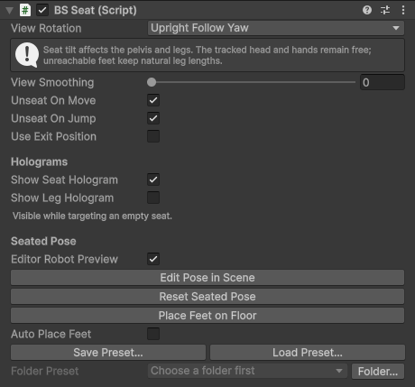

# Spawn, Seats & Settings

The components behind the **Player** prefabs in `GameObject > BS > Player`: where players arrive, seats, teleporters and the space's settings. [Easy Prefabs](../building-in-unity/easy-prefabs.md) covers placing and setting them up in Unity; this page is their JavaScript side.

They're usually placed in Unity. To reach one from your script, find its object and ask for the component:

```js
const scene = BS.Scene.GetInstance();
scene.On("unity-loaded", async () => {
    const seatObject = await scene.Find("SitPoint");
    const seat = seatObject.GetComponent(BS.CT.Seat);
    seat.unseatOnJump = false;
});
```

None of these components raise events of their own.

## Spawn

Where players arrive. When the space loads, one of the spawns in the scene is picked at random and the local player lands there, facing the spawn's Y rotation; see [Spawn Point and Spawn Range](../building-in-unity/easy-prefabs.md#spawn-point-and-spawn-range-bsspawn).

<div class="docs-tabs">

```js
const lobby = new BS.GameObject({
    name: "Lobby Spawn",
    localPosition: new BS.Vector3(0, 0, 5),
    localEulerAngles: new BS.Vector3(0, 180, 0)   // arrive facing back towards the origin
});
const spawn = await lobby.AddComponent(new BS.Spawn({ radius: 2 }));

// Send the local player there
spawn.Spawn();
```


</div>

| Property | Type | Default | What it does |
|---|---|---|---|
| `radius` | number | 0 | Players land at a random point within this many metres of the spawn, on the horizontal plane. 0 lands exactly on it. |

| Method | What it does |
|---|---|
| `Spawn()` | Teleports the local player to this spawn (within its `radius`), facing its Y rotation, with their movement stopped. |

Only spawns that are in the scene while the space loads take part in the arrival pick, so place your spawns in Unity. A spawn your script creates may come too late for it; call `Spawn()` on it to send the player there.

## Seat

Clicking a seat sits the local player on it, and moving or jumping stands them up; see [Seats](../building-in-unity/seats.md) for placement, the Scene view gizmos, posing and vehicles. All modes face the seat on entry and use its authored pelvis and leg pose. Follow Seat carries the full seat rotation; the two upright modes keep seat tilt out of the view. New seats default to Upright Follow Yaw.

The seat's shared [Pointer Range](ui-system.md#pointer-range) component defaults to **2 metres**; change its **Distance** to choose the seat's reach. Clicking, the hover marker, the sit hint and the VR targeting ray use this same head-to-seat-origin distance. Scaling its visual or enlarging its trigger does not extend reach. Moving out of range before releasing the click cancels seating. Editor placement previews and scripted `Sit()` remain available at any distance.

| Property | Type | Default | Description |
|----------|------|---------|-------------|
| `unseatOnMove` | boolean | true | Stand up when the player pushes the move stick (WASD on desktop) |
| `unseatOnJump` | boolean | true | Stand up when the player jumps |
| `useExitPosition` | boolean | false | Teleport the player to `exitPosition` when they get off, however they get off. Off: they are lifted 1 m above the seat, speed cleared |
| `exitPosition` | Vector3 | `0, 0, 0.6` | Where they stand after getting off, relative to the seat (it moves with the seat). `FollowSeat` faces the seat; upright modes preserve viewing direction |
| `viewMode` | SeatViewMode | `BS.SeatViewMode.UprightFollowYaw` | `FollowSeat` (old name `Legacy`) follows full seat rotation; `UprightFollowYaw` follows seat yaw without pitch/roll; `UprightIndependent` ignores all seat rotation for the view. Upright modes stand on world up, or against gravity when the player has Comfort > Gravity Tilting on. All modes use the authored lower-body pose |

Mode and pose are captured on `Sit()`. Set the mode before sitting; changing it while occupied applies at the next sit. The pose remains attached as the seat moves. Head tracking stays free, artificial VR turning is disabled in upright modes, and desktop look remains available. Pose targets use metres independent of seat/parent scale. Head and feet outside the avatar's natural reach are visually clamped without moving the tracked camera or automatically standing the player up.

<div class="docs-tabs">

```js
const chair = new BS.GameObject({
    name: "Chair",
    layer: BS.L.UI,                                  // only the UI and Menu layers can be clicked
    localPosition: new BS.Vector3(0, 0.45, 2),
    localEulerAngles: new BS.Vector3(0, 180, 0)      // the seat's authored forward
});
// The collider first: the seat listens for clicks on the colliders it finds when it starts.
await chair.AddComponent(new BS.BoxCollider({ isTrigger: true, size: new BS.Vector3(0.5, 0.2, 0.5) }));
const seat = await chair.AddComponent(new BS.Seat({
    unseatOnMove: false,
    viewMode: BS.SeatViewMode.UprightFollowYaw
}));

seat.Sit();     // sit the local player down
seat.Stand();   // and stand them up again
```



</div>

| Method | What it does |
|---|---|
| `Sit()` | Sits the local player on this seat, as if they'd clicked it. |
| `Stand()` | Stands the local player up. |

A seat needs a collider to be clicked, on the **UI** or **Menu** layer: on the seat's object or a child, and there when the seat starts, so add it before the seat. The seat also adds a kinematic Rigidbody if it has none, so it stays where you put it. `Sit()` and `Stand()` work without a collider.

### C# and Visual Scripting

Unity-side SDK code uses `BSSeat.ViewMode`, `Pose`, `ShowRuntimeVisual` (the Inspector's **Show Seat Hologram**) and `ShowLegHologram`. A pose is a value: edit a copy and assign it back. For example, given an existing `BSSeat seat`:

```csharp
seat.ViewMode = BS.SeatViewMode.UprightIndependent;
BS.SeatPose pose = seat.Pose;
pose.leftFootPosition += new UnityEngine.Vector3(0f, 0f, 0.05f);
seat.Pose = pose;
seat.ShowRuntimeVisual = true;
seat.ShowLegHologram = true;
seat._Sit();
// seat._Stand();
```

`SeatPose` contains `pelvisPosition` / `pelvisRotation`, `leftFootPosition` / `leftFootRotation`, `rightFootPosition` / `rightFootRotation`, and `leftKneeHint` / `rightKneeHint`. Positions and hints are `Vector3`; rotations are `Quaternion`. Foot positions refer to soles. `BS.SeatPose.Default` and `seat.ResetPose()` restore the standard pose. Invalid or uninitialized pose data falls back to the complete default; valid quaternions are normalized. The detailed pose and hologram toggles are Unity-side authoring/C# settings, not JavaScript wire properties.

In Visual Scripting, use the member setter for **BSSeat.ViewMode** with a `BS.SeatViewMode` value before invoking the seat's **Sit** member (`BSSeat._Sit`). **Stand** uses `BSSeat._Stand`. The supported **ShowRuntimeVisual** and **ShowLegHologram** setters control the two previews independently. Author the detailed pose in the seat Inspector; it is not a graph-driven pose editor. Validate the graph with the SDK's normal allow-list checks.

Keep occupied-seat mode/pose edits out of local multiplayer comparisons: SDK late joins or recreated preview avatars can use the current settings rather than the occupant's earlier snapshot. See [what has been tested and what has not](../building-in-unity/seats.md#tested-and-not-tested): riders on a moving vehicle were measured between two players, and headset comfort has not been judged.

## Teleporter

Teleports the local player when they walk into the teleporter's trigger collider; see [Teleporter](../building-in-unity/easy-prefabs.md#teleporter-bsteleporter).

The landing point, the teleporter's **Destination**, can only be set in Unity, so create teleporters there. A teleporter created from a script has no destination and never teleports anyone. From a script you can change how one behaves, or switch it off:

<div class="docs-tabs">

```js
const gate = await scene.Find("Teleporter");
const teleporter = gate.GetComponent(BS.CT.Teleporter);

teleporter.cooldown = 2;           // fire at most every 2 seconds
teleporter.stopVelocity = false;   // keep the player's momentum through it

await gate.SetActive(false);       // switch it off; true turns it back on
```


</div>

| Property | Type | Default | What it does |
|---|---|---|---|
| `stopVelocity` | boolean | true | Stops the player's movement when they land. |
| `cooldown` | number | 0.5 | Seconds before the teleporter can fire again. |

It has no methods.

## Settings

Sets the space's settings: the players' abilities, the refresh rate and clipping planes, and player physics. They're the same settings `scene.SetSettings` sends, described on the [Scene Settings](../javascript-api/scene-settings.md) page; for placing one in Unity, see [Easy Prefabs](../building-in-unity/easy-prefabs.md#scene-settings-bssettings). Use one per space.

<div class="docs-tabs">

```js
const holder = new BS.GameObject({ name: "Space Settings" });
const settings = await holder.AddComponent(new BS.Settings({
    enableTeleport: false,
    enableSpiderMan: true,
    physicsJumpStrength: 2,
    isSettingsLocked: true      // nothing else may change the settings now
}));

settings.enableTeleport = true; // applies straight away: its own lock doesn't stop it
```


</div>

When it starts, it applies all of its values, so anything you don't set goes back to the default below. After that, each property you change is applied straight away. One placed in Unity applies its values again whenever the page reloads.

**Abilities and display**

| Property | Type | Default | Sets |
|---|---|---|---|
| `enableTeleport` | boolean | true | `EnableTeleport`: players can teleport |
| `enableForceGrab` | boolean | true | `EnableForceGrab`: players can grab objects from a distance. On by default; untick it to forbid distance grab in this space. A component built in a page script (`new BS.BSSettings()`) still starts with it `false`, as it always has, so name it there if you want it on. |
| `enableSpiderMan` | boolean | false | `EnableSpiderMan`: players can use the grapple |
| `enableBirdFlight` | boolean | true | `EnableBirdFlight`: space permission for controller-driven wing flight. Explicit `false` forbids it; the player's Bird Flight preference must also be on. Missing values allow flight. |
| `avatarSyncMode` | string | "social" | `AvatarSyncMode`: how often distant players see each other move. `"social"` thins to once a second past 70 m; `"action"` keeps 2 to 24 updates a second out to 150 m and beyond, for games and flight |
| `enableRun` | boolean | true | `EnableRun`: players can run (hold Shift on desktop, click the left stick while moving in VR). Untick it to keep everyone at this space's walking speed |
| `teleportMaxRange` | number | 0 | `TeleportMaxRange`: the furthest players can teleport here, in metres. 0 leaves it to each player's own Teleport Range (8 m unless they change it, up to 100 m); any other value caps everyone's teleports at that distance |
| `enableBrowserStreaming` | boolean | true | `EnableBrowserStreaming`: players can stream their menu browser into the space. Untick it to forbid that here; browsers placed in the scene are not affected |
| `enableUserUICollider` | boolean | true | `EnableUserUICollider`: pointers land on other players, and clicking one opens their profile. Untick it so pointers pass through players, for a world that aims at them itself |
| `enableMegaphone` | boolean | false | `EnableMegaphone`: anyone can turn their own megaphone on from the radial menu (heard across the room). Off: only moderators can megaphone people. Megaphone Volumes work either way |
| `voiceDistanceMultiplier` | number | 1 | `VoiceDistanceMultiplier`: scales how far voices carry here, on top of each player's own Voice Distance setting: 2 = twice as far (a stage or auditorium), 0.5 = half. Clamped to 0.1-10. Voices beyond that distance aren't received at all, so a large multiplier in a crowded space costs players bandwidth |
| `megaphoneDistanceMultiplier` | number | 0 | `MegaphoneDistanceMultiplier`: scales how far megaphones and friends' walkie-talkies carry here, apart from normal voices: full volume to 40 m and silent at 100 m, times this (10 = silent at 1 km). 0 uses `voiceDistanceMultiplier` for them too, as before. Clamped to 0.1-100, and never shorter than a normal voice's reach. They're received at any distance anyway, so it costs players no bandwidth |
| `enableSafetyNet` | boolean | true | `EnableSafetyNet`: a player who falls below `safetyNetHeight` is put back at their spawn point (or wherever the world last moved them). Untick it to let players fall as far as the world goes; one flung right out of the world (100 km or more away) is still brought back |
| `safetyNetHeight` | number | -250 | `SafetyNetHeight`: the height, in metres, below which the safety net catches a falling player. Keep it below everywhere players can stand or spawn |
| `enableHandHold` | boolean | true | `EnableHandHold`: players can hold hands |
| `enableRadar` | boolean | true | `EnableRadar`: the radar is shown |
| `enableNametags` | boolean | true | `EnableNametags`: name tags show above players |
| `enablePortals` | boolean | true | `EnablePortals`: portals to other spaces are shown |
| `enableGuests` | boolean | true | `EnableGuests`: `false` turns away players who aren't signed in as the space loads |
| `refreshRate` | number | 72 | `RefreshRate`: the display refresh rate on Quest, e.g. 72, 90 or 120 |
| `clippingPlane` | Vector2 | (0.02, 1500) | `ClippingPlane`: the camera's near (`x`) and far (`y`) clipping planes, in metres |

**Player physics**

| Property | Type | Default | Sets |
|---|---|---|---|
| `physicsMoveSpeed` | number | 3.25 | `PhysicsMoveSpeed`: walking speed, in metres per second |
| `physicsMoveAcceleration` | number | 4.6 | `PhysicsMoveAcceleration`: how hard players push off to reach walking speed; below 2.2 is raised to 2.2 |
| `physicsAirControlSpeed` | number | 2.4 | `PhysicsAirControlSpeed`: how fast players can steer in the air, in metres per second |
| `physicsAirControlAcceleration` | number | 6 | `PhysicsAirControlAcceleration`: how quickly they steer in the air |
| `physicsDrag` | number | 0 | `PhysicsDrag`: drag on the player's body |
| `physicsFreeFallAngularDrag` | number | 6 | `PhysicsFreeFallAngularDrag`: angular drag while falling |
| `physicsJumpStrength` | number | 1 | `PhysicsJumpStrength`: jump strength multiplier |
| `physicsHandPositionStrength` | number | 1 | `PhysicsHandPositionStrength`: how strongly the hands follow the controllers' position |
| `physicsHandRotationStrength` | number | 1 | `PhysicsHandRotationStrength`: how strongly the hands follow the controllers' rotation |
| `physicsHandSpringiness` | number | 10 | `PhysicsHandSpringiness`: springiness of the hands |
| `physicsGrappleRange` | number | 512 | `PhysicsGrappleRange`: grapple range, in metres |
| `physicsGrappleReelSpeed` | number | 1 | `PhysicsGrappleReelSpeed`: grapple reel speed |
| `physicsGrappleSpringiness` | number | 10 | `PhysicsGrappleSpringiness`: grapple springiness |
| `physicsGorillaMode` | boolean | false | `PhysicsGorillaMode`: in VR, players move by pushing their hands against the floor and walls instead of with the sticks |

`enableHandHold`, `enableRadar`, `enablePortals` and `physicsFreeFallAngularDrag` don't work in the app yet: see [Not working yet](../javascript-api/scene-settings.md#not-working-yet). In SDK Play Mode only `clippingPlane` has an effect.

**Locks**

| Property | Type | Default | What it does |
|---|---|---|---|
| `isSettingsLocked` | boolean | false | Locks the abilities, refresh rate and clipping planes once this component's values are in. Until the page reloads, `scene.SetSettings` and any other Settings component can't change them; this component still can. |
| `isPhysicsSettingsLocked` | boolean | false | The same for the player physics settings. |
| `isMegaphoneLocked` | boolean | false | Locks the megaphone: only moderators can megaphone people, and [Megaphone Volumes](special.md#megaphonevolume) and `enableMegaphone` stop working. Players can still turn their own megaphone off. Once on it stays on until the player leaves or rejoins the space: nothing can unlock it before then, this component included. |

Locks only ever lock: setting one back to `false` doesn't unlock the settings. A lock someone else set first also stops this component: it leaves those settings alone.

`scene.SetSettings(...)` sends every setting, so a call that runs after this component started replaces all of its values, unless they're locked.

It has no methods.
