# UI Kit

The UI Kit is a set of ready-made controls for your world's panels, in the look of the Altspace menu: pill buttons and switches, sliders, chips, tabs, cards, a modal window, and the type, colours and spacing that hold them together. You can place them in Unity's UI Builder, create them from JavaScript, or create them from Visual Scripting. It is the same set of controls each way, with the same property names.

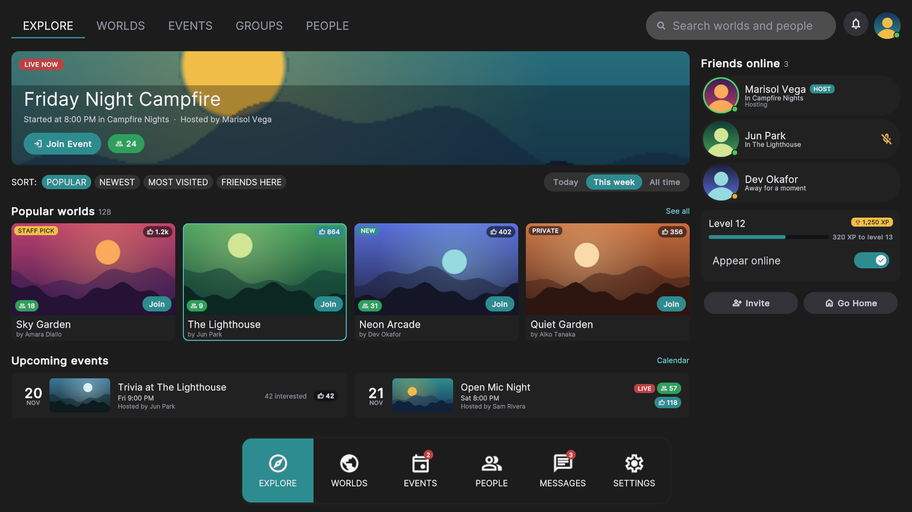

The kit comes with the creator SDK, as the package `com.sidequest.creator-sdk.ui-kit`: there is nothing extra to install. It needs an SDK <!-- kit:min-sdk -->newer than 4.0.28<!-- /kit:min-sdk -->, and players need an app version that includes the kit. An older app does not have the controls: one made from a script shows as an empty element, and a page made in the UI Builder shows without its kit controls.

## How it is organised

The kit follows atomic design: small pieces, and bigger pieces made from them.

| Level | What it is | Examples |
|---|---|---|
| [Tokens](#tokens-and-theming) | The named colours, sizes and timings everything else uses | `--alt-colour-accent`, `--alt-space-4` |
| [Atoms](#atoms) | One control that does one thing | KitButton, KitToggle, KitSlider, KitText, KitIcon |
| [Molecules](#molecules) | A few atoms working together | KitSearchBar, KitOptionRow, KitTabs |
| [Organisms](#organisms) | A complete part of a page | KitCard, KitModal, KitNavBar |
| [Templates](#templates) | A whole page layout to start from | Browse page, Settings page |

Every control is drawn on a [UI Panel](ui-system.md#uipanel). Read [UI System](ui-system.md) first if you have not made a panel yet.

To see every control in the editor, open **Window > UI Toolkit > Altspace UI Kit Gallery** (also listed in the SDK's Setup panel).

Text in a kit control is plain text: tags such as `<b>` or `<color>` are shown as written. Use a control's `variant`, `tone` and `size` for emphasis.

## Three ways to use it

### In the UI Builder

1. In Unity, right-click in the Project window and choose **Create > UI Toolkit > UI Document** to make a UXML file, and open it (double-click) in the UI Builder. To start from a whole page instead, choose **Create > BS > UI Kit** and pick a [template](#templates).
2. In the **Library** pane, open the **Project** tab and expand **Custom Controls (C#) > BS > UIKit**. Drag controls onto the canvas and set their properties in the Inspector. The kit's look appears as soon as the first kit control is on the canvas.
3. Add a **UI Document** component to the same GameObject as your **BS UI Panel** and give it your UXML file. The panel shows it in the world.

A few things to know:

- **Don't add the kit's style sheet to your UXML.** Kit controls bring their look with them. A UXML file that references the kit's sheet would carry a copy of it into your world.
- **Pictures are set in the Inspector.** A control's `image` takes a texture from your project, and it is built into your world with the page.
- **Give an element a name** (the **Name** field in the Inspector) if a Visual Scripting graph needs to reach it. Every UI node has an **Element Name** input that takes that name.
- **JavaScript cannot reach an element that came from a UXML file.** A script can add its own elements to the same panel, but it has no way to get hold of the ones you placed in the UI Builder. If your world is scripted in JavaScript, create the controls from the script.
- In UXML an option from a list is written with capitals and no dashes (`variant="BodyLarge"`); scripts write the same option as `"body-large"`. The UI Builder's Inspector writes it for you.

### From JavaScript

Every kit control is a class on `BS`, named `UI` plus the control's name. You create it for a panel like any other element, set properties, and listen for events.

```js
const panelObj = new BS.GameObject({ name: "Menu", localPosition: new BS.Vector3(0, 1.5, 2) });
const panel = await panelObj.AddComponent(new BS.UIPanel({ resolution: new BS.Vector2(640, 360) }));

const surface = new BS.UIKitSurface(panel);
surface.padding = "s5";

const title = new BS.UIKitText(panel, surface);
title.text = "Tonight";
title.variant = "heading";

const join = new BS.UIKitButton(panel, surface);
join.text = "Join";
join.icon = "login";
join.OnClick(() => console.log("joining"));
```

- The second argument is the parent: leave it out to put the control on the panel itself.
- A property that is one of a set of words (`variant`, `size`, `tone`) takes the word in lower case with dashes: `"body-large"`.
- A list (`choices`, `badges`) is one string with `;` between the entries: `"Newest;Popular;Nearby"`. Write `\;` for a semicolon inside an entry.
- A picture property (`image`) takes whatever `background-image` takes: a URL, a `data:` URI, or `res:` for something in a Resources folder. An empty string clears it.
- A control with parts you can press, such as a card with a Join button, tells you which part with a **named action**: it arrives through `OnChange`, and `e.value` is the action's name (`"card:action"`). The control's section lists its actions.
- `OnChange` on a control with a value (a toggle, a slider, tabs, a dropdown) fires when the player changes it, not when your script sets it.
- A change event travels up through the controls it sits in. So `OnChange` on a container also hears the named actions and the text values (a text field, tabs, a dropdown) of what is inside it; check `e.value` (action names all have a colon, such as `card:action`) or listen on the inner control.
- A modal closes itself when the player presses its cross or outside it, and tells you with `modal:close`. To show it again, set `open = true` again.
- `ui.CreateKitButton()`, `ui.CreateKitCard()` and so on are shortcuts on a [`BS.UI`](ui-system.md#ui-factory-helpers) panel. Each takes an optional parent.

### From Visual Scripting

- **Create UI Element** makes any kit control: pick it in the **Element Type** list (`KitButton`, `KitCard`, …).
- **Set UI Kit Property** sets one property by name. Type the property's name in **Property** exactly as it is written in the tables below, capitals included (`variant`, `text`, `actionText`), and connect the **Value**: text, a number or a Boolean. It works on kit controls only, and only for the names in their tables; for anything else (`tooltip`, `enabled`, `visible`) use **Set UI Property**.
- **On UI Click** and **On UI Change** work as for any element. A named action arrives through **On UI Change** with the action's name as its value.
- **Add UI Class** and **Remove UI Class** put a style class on an element.

Each of these nodes takes an **Element ID** (from the node that created the element) or an **Element Name** (the name you gave an element in the UI Builder).

## Layout: classes on plain elements

The kit's look is a set of style classes, and every panel has them. A plain element can use them without being a kit control: give it the class `alt` first, then the classes you want.

USS has no gap and no grid, so the kit has helper classes for the layout around its controls:

<!-- kit:begin helpers -->

| Class | What it does |
|---|---|
| `alt-row` | Children side by side, centred on the row. |
| `alt-row--top`, `alt-row--bottom`, `alt-row--stretch` | With `alt-row`: children at the top, at the bottom, or as tall as the row. |
| `alt-row--between`, `alt-row--end`, `alt-row--centre` | With `alt-row`: children pushed apart, to the right end, or to the middle. |
| `alt-column`, `alt-column--centre` | Children one under another; `--centre` centres them. |
| `alt-grow` | Takes the room that is left in its row or column. |
| `alt-no-shrink` | Keeps its size when the row or column is too small. |
| `alt-fill` | Fills its parent: for the root of a page, or a layer over one. |
| `alt-grid` | A wrapping grid. Put each item in a cell. |
| `alt-cell-1of1`, `alt-cell-1of2`, `alt-cell-1of3`, `alt-cell-1of4`, `alt-cell-1of5` | A grid cell: one, two, three, four or five to a row, with the gutter between them. |
| `alt-pad-0`, `alt-pad-1`, `alt-pad-2`, `alt-pad-3`, `alt-pad-4`, `alt-pad-5`, `alt-pad-6` | Padding on all sides: 0, 4, 8, 12, 16, 24 or 32 px. |
| `alt-mt-1` to `alt-mt-6` | Space above: 4, 8, 12, 16, 24 or 32 px. |
| `alt-mb-1` to `alt-mb-6` | Space below. |
| `alt-ml-1` to `alt-ml-6` | Space to the left. |
| `alt-mr-1` to `alt-mr-6` | Space to the right. |

<!-- kit:end helpers -->

In the UI Builder, type them into an element's class list. From a script:

```js
const grid = new BS.UIVisualElement(panel);
grid.AddClass("alt");
grid.AddClass("alt-grid");

for (const world of worlds) {
    const cell = new BS.UIVisualElement(panel, grid);
    cell.AddClass("alt");
    cell.AddClass("alt-cell-1of3");

    const card = new BS.UIKitCard(panel, cell);
    card.title = world.name;
    card.image = world.picture;
    card.actionText = "Join";
    card.OnChange((e) => { if (e.value === "card:action") join(world); });
}
```

A plain element can also wear a control's look: `alt alt-surface alt-surface--raised` is a raised panel. A control's own class is in the [reference](#reference); its looks follow one pattern, `alt-button--secondary` for a variant, `alt-button--size-lg` for a size, `alt-badge--tone-danger` for a colour role.

## Tokens and theming

Every colour, size and timing in the kit has a name. The controls only ever use the names, so changing a value changes it everywhere.

<!-- kit:begin tokens -->

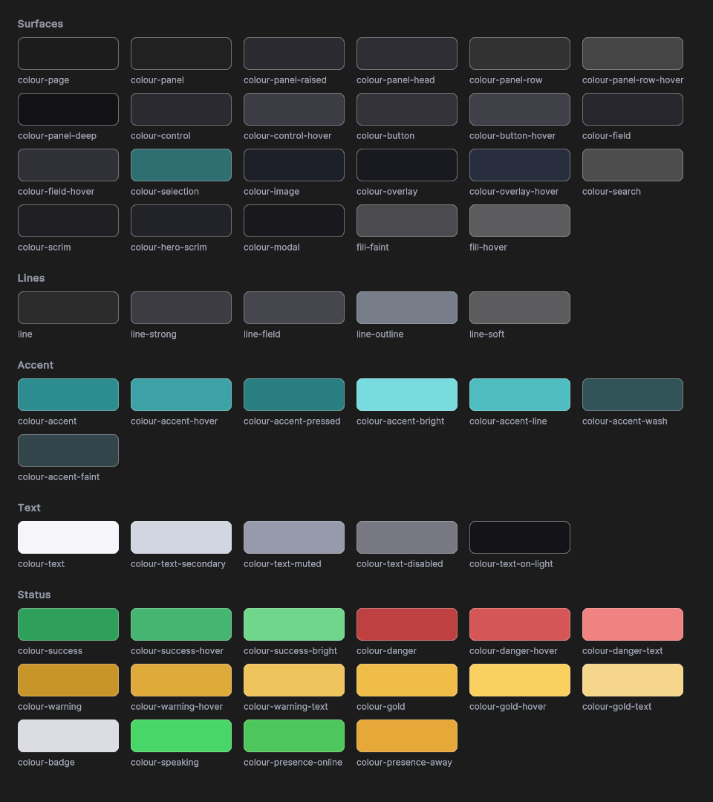

**Surfaces**

| Token | Value |
|---|---|
| `--alt-colour-page` | `rgb(28, 28, 28)` |
| `--alt-colour-panel` | `rgb(34, 34, 34)` |
| `--alt-colour-panel-raised` | `rgb(42, 42, 48)` |
| `--alt-colour-panel-head` | `rgb(46, 46, 52)` |
| `--alt-colour-panel-row` | `rgb(50, 50, 50)` |
| `--alt-colour-panel-row-hover` | `rgb(69, 69, 69)` |
| `--alt-colour-panel-deep` | `rgb(18, 18, 22)` |
| `--alt-colour-control` | `rgb(42, 42, 48)` |
| `--alt-colour-control-hover` | `rgb(60, 60, 68)` |
| `--alt-colour-button` | `rgb(50, 50, 56)` |
| `--alt-colour-button-hover` | `rgb(64, 64, 72)` |
| `--alt-colour-field` | `rgb(38, 38, 44)` |
| `--alt-colour-field-hover` | `rgb(48, 48, 56)` |
| `--alt-colour-selection` | `rgba(45, 140, 143, 0.55)` |
| `--alt-colour-image` | `rgb(30, 32, 40)` |
| `--alt-colour-overlay` | `rgba(15, 17, 24, 0.82)` |
| `--alt-colour-overlay-hover` | `rgba(40, 46, 62, 0.92)` |
| `--alt-colour-search` | `rgb(77, 77, 77)` |
| `--alt-colour-scrim` | `rgba(0, 0, 0, 0.55)` |
| `--alt-colour-hero-scrim` | `rgba(10, 12, 18, 0.55)` |
| `--alt-colour-modal` | `rgba(24, 24, 28, 0.98)` |
| `--alt-fill-faint` | `rgba(255, 255, 255, 0.04)` |
| `--alt-fill-hover` | `rgba(255, 255, 255, 0.08)` |

**Lines**

| Token | Value |
|---|---|
| `--alt-line` | `rgb(44, 44, 44)` |
| `--alt-line-strong` | `rgb(60, 60, 66)` |
| `--alt-line-field` | `rgb(70, 70, 78)` |
| `--alt-line-outline` | `rgb(120, 124, 138)` |
| `--alt-line-soft` | `rgba(255, 255, 255, 0.08)` |

**Accent**

| Token | Value |
|---|---|
| `--alt-colour-accent` | `rgb(45, 140, 143)` |
| `--alt-colour-accent-hover` | `rgb(61, 162, 165)` |
| `--alt-colour-accent-pressed` | `rgb(40, 126, 129)` |
| `--alt-colour-accent-bright` | `rgb(120, 220, 222)` |
| `--alt-colour-accent-line` | `rgb(80, 190, 192)` |
| `--alt-colour-accent-wash` | `rgba(45, 140, 143, 0.25)` |
| `--alt-colour-accent-faint` | `rgba(45, 140, 143, 0.12)` |

**Text**

| Token | Value |
|---|---|
| `--alt-colour-text` | `rgb(245, 245, 250)` |
| `--alt-colour-text-secondary` | `rgb(210, 214, 224)` |
| `--alt-colour-text-muted` | `rgb(150, 154, 170)` |
| `--alt-colour-text-disabled` | `rgb(120, 120, 130)` |
| `--alt-colour-text-on-light` | `rgb(20, 20, 24)` |

**Status**

| Token | Value |
|---|---|
| `--alt-colour-success` | `rgb(46, 160, 92)` |
| `--alt-colour-success-hover` | `rgb(68, 182, 114)` |
| `--alt-colour-success-bright` | `rgb(110, 214, 140)` |
| `--alt-colour-danger` | `rgb(190, 64, 64)` |
| `--alt-colour-danger-hover` | `rgb(212, 86, 86)` |
| `--alt-colour-danger-text` | `rgb(240, 130, 130)` |
| `--alt-colour-warning` | `rgb(200, 150, 40)` |
| `--alt-colour-warning-hover` | `rgb(222, 170, 58)` |
| `--alt-colour-warning-text` | `rgb(240, 196, 92)` |
| `--alt-colour-gold` | `rgb(240, 190, 72)` |
| `--alt-colour-gold-hover` | `rgb(250, 208, 96)` |
| `--alt-colour-gold-text` | `rgb(245, 214, 138)` |
| `--alt-colour-badge` | `rgb(220, 220, 228)` |
| `--alt-colour-speaking` | `rgb(72, 214, 104)` |
| `--alt-colour-presence-online` | `rgb(77, 199, 92)` |
| `--alt-colour-presence-away` | `rgb(230, 168, 56)` |

**Radii**

| Token | Value |
|---|---|
| `--alt-radius-tile` | `8px` |
| `--alt-radius-card` | `12px` |
| `--alt-radius-control` | `16px` |
| `--alt-radius-panel` | `20px` |
| `--alt-radius-modal` | `24px` |

**Spacing**

| Token | Value |
|---|---|
| `--alt-space-1` | `4px` |
| `--alt-space-2` | `8px` |
| `--alt-space-3` | `12px` |
| `--alt-space-4` | `16px` |
| `--alt-space-5` | `24px` |
| `--alt-space-6` | `32px` |
| `--alt-space-7` | `48px` |
| `--alt-space-8` | `64px` |

**Control heights**

| Token | Value |
|---|---|
| `--alt-height-xs` | `32px` |
| `--alt-height-sm` | `36px` |
| `--alt-height-md` | `40px` |
| `--alt-height-lg` | `46px` |
| `--alt-height-xl` | `52px` |
| `--alt-height-xxl` | `60px` |

**Type scale**

| Token | Value |
|---|---|
| `--alt-font-size-caption` | `12px` |
| `--alt-font-size-eyebrow` | `13px` |
| `--alt-font-size-small` | `14px` |
| `--alt-font-size-body` | `16px` |
| `--alt-font-size-body-lg` | `18px` |
| `--alt-font-size-label` | `20px` |
| `--alt-font-size-heading` | `22px` |
| `--alt-font-size-tab` | `24px` |
| `--alt-font-size-title` | `30px` |
| `--alt-font-size-display` | `34px` |
| `--alt-font-size-hero` | `40px` |

**Icon sizes**

| Token | Value |
|---|---|
| `--alt-icon-xs` | `14px` |
| `--alt-icon-sm` | `16px` |
| `--alt-icon-md` | `24px` |
| `--alt-icon-lg` | `32px` |
| `--alt-icon-xl` | `45px` |

**Motion**

| Token | Value |
|---|---|
| `--alt-motion-fast` | `0.15s` |
| `--alt-motion-slide` | `0.22s` |
| `--alt-motion-knob` | `0.25s` |
| `--alt-motion-toggle` | `0.35s` |

<!-- kit:end tokens -->

**To re-theme a panel made in the UI Builder**, add a style sheet of your own to the root of your UXML and set the tokens you want to change:

```css
:root {
    --alt-colour-accent: rgb(139, 92, 246);
    --alt-colour-accent-hover: rgb(167, 139, 250);
    --alt-colour-accent-pressed: rgb(124, 58, 237);
}
```

**From a script you cannot set a token**, but three ready-made accent colours are there as classes. Put one on an element that also has the class `alt`, and every kit control inside it uses that accent, a dropdown's list included: `alt-theme--violet`, `alt-theme--amber`, `alt-theme--rose`.

```js
const page = new BS.UIKitSurface(panel);
page.AddClass("alt-theme--violet");
```

For anything else, use the controls' own properties (`variant`, `tone`, `size`) and ordinary [styles](ui-system.md#style-properties-reference) on the element. A style you set on an element replaces the kit's for that element, including its hover and pressed colours, so prefer a `variant` or `tone` where one fits.

The kit sets no font. A world panel uses the SDK's font (Inter).

## Atoms

<!-- kit:begin atoms -->

### KitText

Text in one step of the type scale.

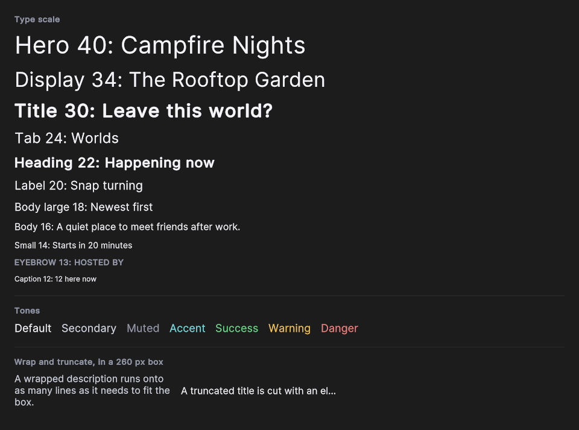

| Property | UXML attribute | Type | Default | What it does |
|---|---|---|---|---|
| `text` | `text` | text | — | The text shown. |
| `variant` | `variant` | `caption`, `eyebrow`, `small`, `body`, `body-large`, `label`, `heading`, `tab`, `title`, `display`, `hero` | `body` | Step of the type scale. |
| `tone` | `tone` | `default`, `secondary`, `muted`, `accent`, `success`, `warning`, `danger` | `default` | Colour role. `default` keeps the variant's own colour. |
| `wrap` | `wrap` | true / false | `false` | Wrap onto more lines instead of staying on one. |
| `truncate` | `truncate` | true / false | `false` | Cut with an ellipsis when the text does not fit. |

JavaScript: `BS.UIKitText`, element type 200.

```js
const text = new BS.UIKitText(panel);
text.text = "Secondary";
text.variant = "body-large";
text.tone = "secondary";
```

UI Builder (UXML):

```xml
<BS.UIKit.KitText text="Secondary" variant="BodyLarge" tone="Secondary" />
```

### KitIcon

A square glyph from the kit's icon set, or your own picture.

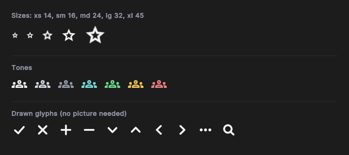

| Property | UXML attribute | Type | Default | What it does |
|---|---|---|---|---|
| `icon` | `icon` | text | — | Glyph name in kebab-case, such as `check` or `how-to-reg`. |
| `size` | `size` | `xs`, `sm`, `md`, `lg`, `xl` | `md` | Size step: 14, 16, 24, 32 or 45 px. |
| `tone` | `tone` | `default`, `secondary`, `muted`, `accent`, `success`, `warning`, `danger` | `default` | Colour role. |
| `image` | `image` | picture | — | Your own picture instead of a named glyph. It is tinted like a glyph, so use a white picture. |

JavaScript: `BS.UIKitIcon`, element type 201.

```js
const icon = new BS.UIKitIcon(panel);
icon.icon = "groups";
icon.size = "lg";
icon.tone = "secondary";
icon.image = "https://example.com/picture.png";
```

UI Builder (UXML):

```xml
<BS.UIKit.KitIcon icon="groups" size="Lg" tone="Secondary" />
```

### KitImage

A picture with rounded corners and a placeholder colour until a picture is set.

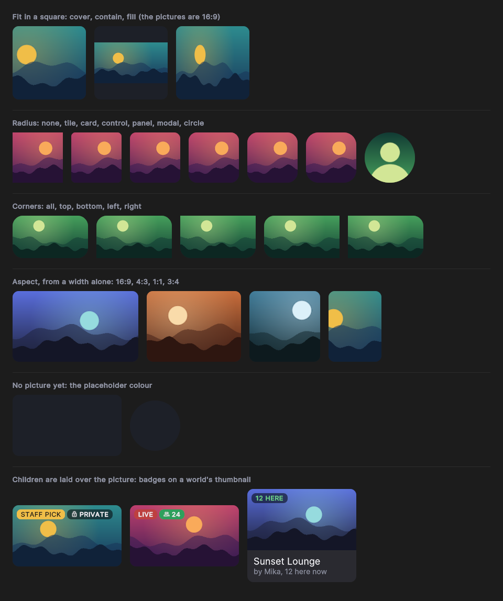

| Property | UXML attribute | Type | Default | What it does |
|---|---|---|---|---|
| `image` | `image` | picture | — | The picture. Until one is set the control shows a dark placeholder colour. |
| `fit` | `fit` | `cover`, `contain`, `fill` | `cover` | `cover` fills the control and crops the picture, `contain` shows all of it, `fill` stretches it. |
| `radius` | `radius` | `none`, `tile`, `card`, `control`, `panel`, `modal`, `circle` | `card` | Corner radius step. `circle` makes a square picture round. |
| `corners` | `corners` | `all`, `top`, `bottom`, `left`, `right` | `all` | Which corners are rounded. A thumbnail on top of a card rounds only its `top` corners. |
| `aspect` | `aspect` | number | `0` | Width divided by height, such as `1.78` for 16:9: the control keeps that shape. 0 for none. |

**Children:** Children are laid over the picture.

JavaScript: `BS.UIKitImage`, element type 202.

```js
const image = new BS.UIKitImage(panel);
image.radius = "panel";
image.corners = "top";
image.image = "https://example.com/picture.png";
```

UI Builder (UXML):

```xml
<BS.UIKit.KitImage radius="Panel" corners="Top" />
```

### KitButton

A pill button with text, an optional icon, seven variants and six heights.

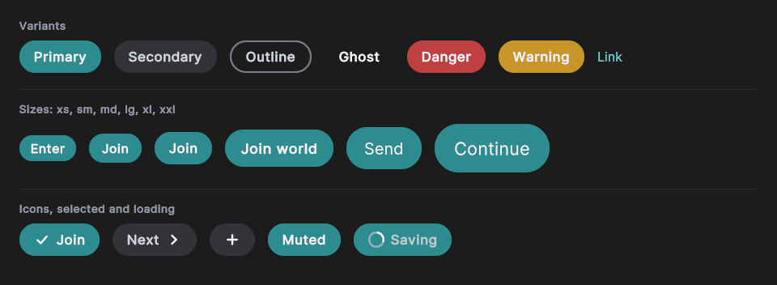

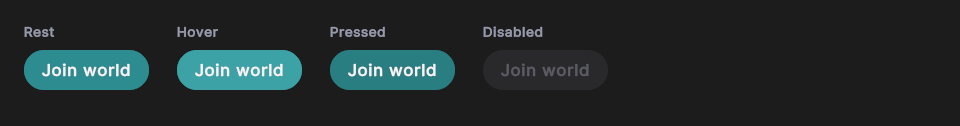

| Property | UXML attribute | Type | Default | What it does |
|---|---|---|---|---|
| `text` | `text` | text | — | The label. |
| `icon` | `icon` | text | — | Glyph name shown beside the label; empty for none. |
| `iconPosition` | `icon-position` | `leading`, `trailing` | `leading` | Which side of the label the icon sits on. |
| `variant` | `variant` | `primary`, `secondary`, `outline`, `ghost`, `danger`, `warning`, `link` | `primary` | The look. |
| `size` | `size` | `xs`, `sm`, `md`, `lg`, `xl`, `xxl` | `md` | Height step: 32, 36, 40, 46, 52 or 60 px. |
| `block` | `block` | true / false | `false` | Stretch to the width of the parent. |
| `selected` | `selected` | true / false | `false` | Show as switched on (teal), for buttons used as a switch. |
| `loading` | `loading` | true / false | `false` | Show a spinner in place of the icon. |

**Children:** Children are added after the label.

JavaScript: `BS.UIKitButton`, element type 203.

```js
const button = new BS.UIKitButton(panel);
button.text = "Next";
button.icon = "chevron-right";
button.iconPosition = "trailing";
button.variant = "secondary";
button.OnClick(() => console.log("button pressed"));
```

UI Builder (UXML):

```xml
<BS.UIKit.KitButton text="Next" icon="chevron-right" icon-position="Trailing" variant="Secondary" />
```

### KitIconButton

A round button holding one glyph, in seven variants and five diameters.

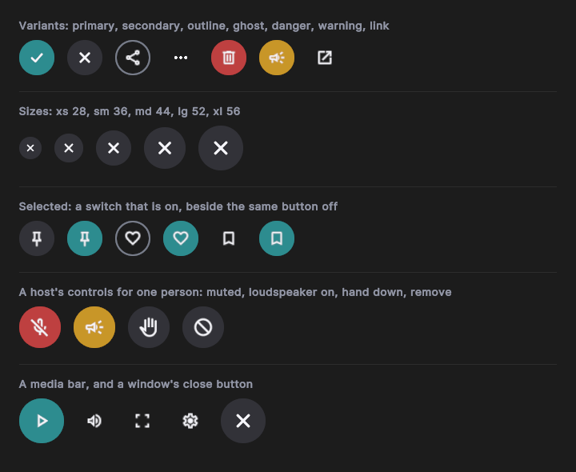

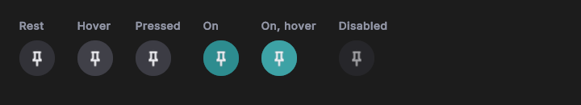

| Property | UXML attribute | Type | Default | What it does |
|---|---|---|---|---|
| `icon` | `icon` | text | — | Glyph name in kebab-case, such as `close` or `push-pin`. |
| `size` | `size` | `xs`, `sm`, `md`, `lg`, `xl` | `md` | Diameter: 28, 36, 44, 52 or 56 px. The glyph is about half of it. |
| `variant` | `variant` | `primary`, `secondary`, `outline`, `ghost`, `danger`, `warning`, `link` | `secondary` | The look. `link` looks like `ghost`. |
| `selected` | `selected` | true / false | `false` | Show as switched on (teal). A press does not change it: set it when you handle the click. |

**Children:** Children are laid over the button.

JavaScript: `BS.UIKitIconButton`, element type 204.

```js
const iconButton = new BS.UIKitIconButton(panel);
iconButton.icon = "favorite";
iconButton.variant = "outline";
iconButton.selected = true;
iconButton.OnClick(() => console.log("iconButton pressed"));
```

UI Builder (UXML):

```xml
<BS.UIKit.KitIconButton icon="favorite" variant="Outline" selected="true" />
```

### KitTextField

A text field with an optional label, placeholder and icon, in six heights.

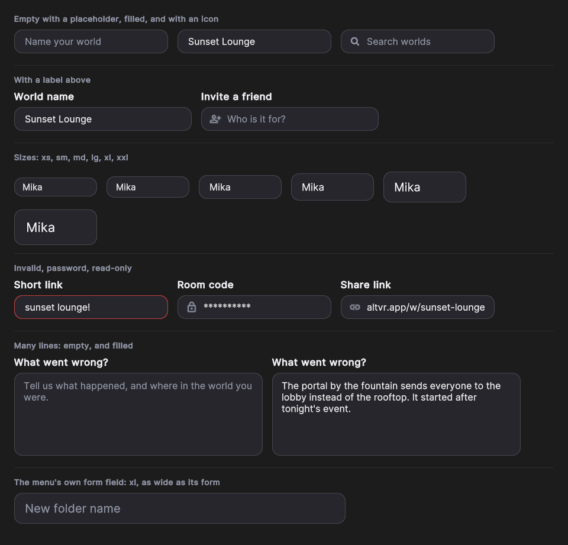

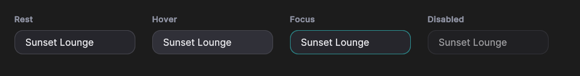

| Property | UXML attribute | Type | Default | What it does |
|---|---|---|---|---|
| `value` | `value` | text | — | The text. Setting it from a script raises no change event. Also accepted as `text`. |
| `label` | `label` | text | — | Text shown above the field; empty for none. |
| `placeholder` | `placeholder-text` | text | — | Quieter text shown while the field is empty. |
| `multiline` | `multiline` | true / false | `false` | Take more than one line: the field becomes a tall box with the text at its top left. |
| `maxLength` | `max-length` | whole number | `-1` | Most characters the user can type; -1 for no limit. |
| `isReadOnly` | `readonly` | true / false | `false` | Show the text and let it be selected, but not changed. |
| `isPasswordField` | `password` | true / false | `false` | Show a dot for each character. |
| `size` | `size` | `xs`, `sm`, `md`, `lg`, `xl`, `xxl` | `md` | Height step of a one-line field: 32, 36, 40, 46, 52 or 60 px. |
| `invalid` | `invalid` | true / false | `false` | Show a red border, for text that cannot be accepted. |
| `icon` | `icon` | text | — | Glyph name shown at the left of the field, such as `search`; empty for none. |

**Children:** Children are added under the field.

JavaScript: `BS.UIKitTextField`, element type 205.

```js
const textField = new BS.UIKitTextField(panel);
textField.label = "Invite a friend";
textField.placeholder = "Who is it for?";
textField.icon = "person-add";
textField.OnChange((e) => console.log(e.value));
```

UI Builder (UXML):

```xml
<BS.UIKit.KitTextField label="Invite a friend" placeholder-text="Who is it for?" icon="person-add" />
```

### KitToggle

A pill switch.

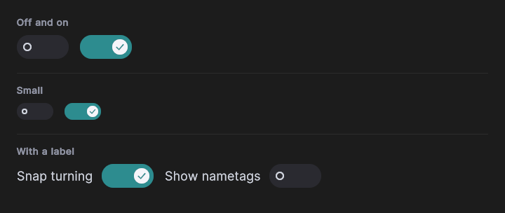

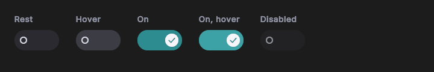

| Property | UXML attribute | Type | Default | What it does |
|---|---|---|---|---|
| `checked` | `value` | true / false | `false` | On or off. Setting it from a script raises no change event. Also accepted as `value`. |
| `label` | `label` | text | — | Text shown to the left of the switch. |
| `size` | `size` | `sm`, `md` | `md` | `md` is 74 x 34 px, `sm` is 52 x 24 px. |

JavaScript: `BS.UIKitToggle`, element type 206.

```js
const toggle = new BS.UIKitToggle(panel);
toggle.checked = true;
toggle.size = "sm";
toggle.OnChange((e) => console.log(e.value));
```

UI Builder (UXML):

```xml
<BS.UIKit.KitToggle value="true" size="Sm" />
```

### KitSlider

A pill slider with a fill and an optional value read-out.

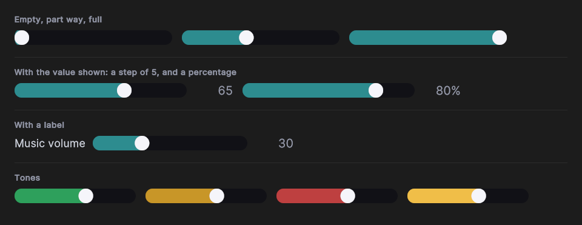

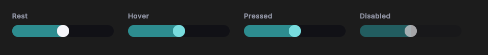

| Property | UXML attribute | Type | Default | What it does |
|---|---|---|---|---|
| `value` | `value` | number | `0` | The value. Setting it from a script raises no change event. It may be set before the range: a value outside the range of the moment is kept and used once the range allows it. |
| `minValue` | `low-value` | number | `0` | The smallest value. The range runs from the smaller of the two ends to the larger, whichever is set first. Also accepted as `lowValue`, `minvalue`. |
| `maxValue` | `high-value` | number | `10` | The largest value. Also accepted as `highValue`, `maxvalue`. |
| `step` | `step` | number | `0` | Snap the value to multiples of this from the low value; 0 for no snapping. |
| `showValue` | `show-value` | true / false | `false` | Show the value as text to the right. |
| `valueFormat` | `value-format` | text | `0.##` | How the value text is written: a pattern of `0 # . , %` such as `0.#` or `0%`, or one of the letters F, N, P with one digit (`F1`). Anything else is read as `0.##`. |
| `label` | `label` | text | — | Text shown to the left of the slider. |
| `tone` | `tone` | `neutral`, `accent`, `success`, `warning`, `danger`, `gold` | `accent` | Colour of the fill. |

JavaScript: `BS.UIKitSlider`, element type 207.

```js
const slider = new BS.UIKitSlider(panel);
slider.value = 65;
slider.maxValue = 100;
slider.step = 5;
slider.showValue = true;
slider.OnChange((e) => console.log(e.value));
```

UI Builder (UXML):

```xml
<BS.UIKit.KitSlider value="65" high-value="100" step="5" show-value="true" />
```

### KitDropdown

A pill that opens a list of entries to pick one from.

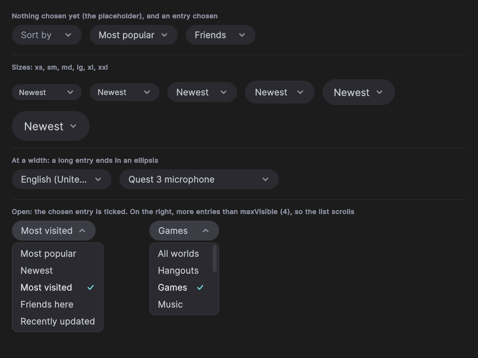

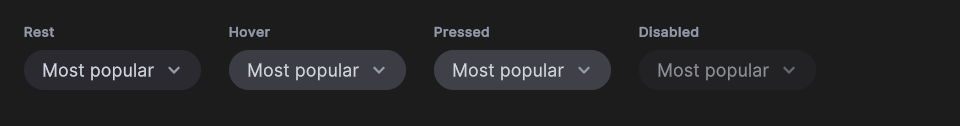

| Property | UXML attribute | Type | Default | What it does |
|---|---|---|---|---|
| `choices` | `choices` | list (`a;b;c`) | — | The entries to pick from, such as `Newest;Popular;Nearby`. |
| `value` | `value` | text | — | The chosen entry, or empty for none. Setting it from a script raises no change event. |
| `index` | `index` | whole number | `-1` | Position of the chosen entry, counted from 0; -1 for none, and a position past the end is the last entry. Setting it raises no change event. |
| `placeholder` | `placeholder` | text | — | Quieter text shown while nothing is chosen. |
| `size` | `size` | `xs`, `sm`, `md`, `lg`, `xl`, `xxl` | `md` | Height step: 32, 36, 40, 46, 52 or 60 px. |
| `open` | `open` | true / false | `false` | Whether the list is showing. |
| `maxVisible` | `max-visible` | whole number | `6` | Most entries shown at once, from 1 to 20; a longer list scrolls. |

**Children:** Children are added inside the pill, between the chosen entry and the chevron.

JavaScript: `BS.UIKitDropdown`, element type 208.

```js
const dropdown = new BS.UIKitDropdown(panel);
dropdown.choices = "Everyone;Friends;Invite only";
dropdown.value = "Friends";
dropdown.index = 1;
dropdown.OnChange((e) => console.log(e.value));
```

UI Builder (UXML):

```xml
<BS.UIKit.KitDropdown choices="Everyone;Friends;Invite only" value="Friends" index="1" />
```

### KitChip

A small pill the user presses to filter or sort, with an optional icon, count and caret.

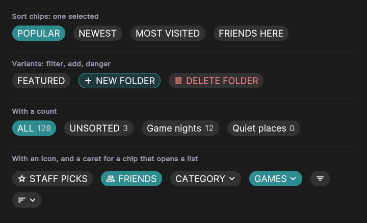

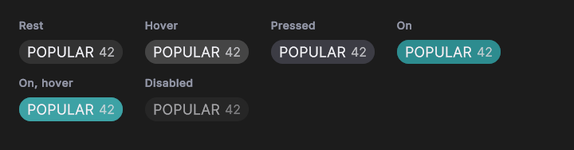

| Property | UXML attribute | Type | Default | What it does |
|---|---|---|---|---|
| `text` | `text` | text | — | The label. |
| `selected` | `selected` | true / false | `false` | Show as switched on (teal). A press does not change it: set it when you handle the click. |
| `count` | `count` | text | — | Quieter text after the label, such as a number of results; empty for none. |
| `icon` | `icon` | text | — | Glyph name shown before the label; empty for none. |
| `caret` | `caret` | true / false | `false` | Show a down chevron after the label, for a chip that opens a list. |
| `variant` | `variant` | `filter`, `add`, `danger` | `filter` | The look: `filter` is the plain chip, `add` has a teal outline, `danger` has red text. |

JavaScript: `BS.UIKitChip`, element type 209.

```js
const chip = new BS.UIKitChip(panel);
chip.text = "NEW FOLDER";
chip.icon = "add";
chip.variant = "add";
chip.OnClick(() => console.log("chip pressed"));
```

UI Builder (UXML):

```xml
<BS.UIKit.KitChip text="NEW FOLDER" icon="add" variant="Add" />
```

### KitBadge

A small label for a card or a header, in six tones and three looks.

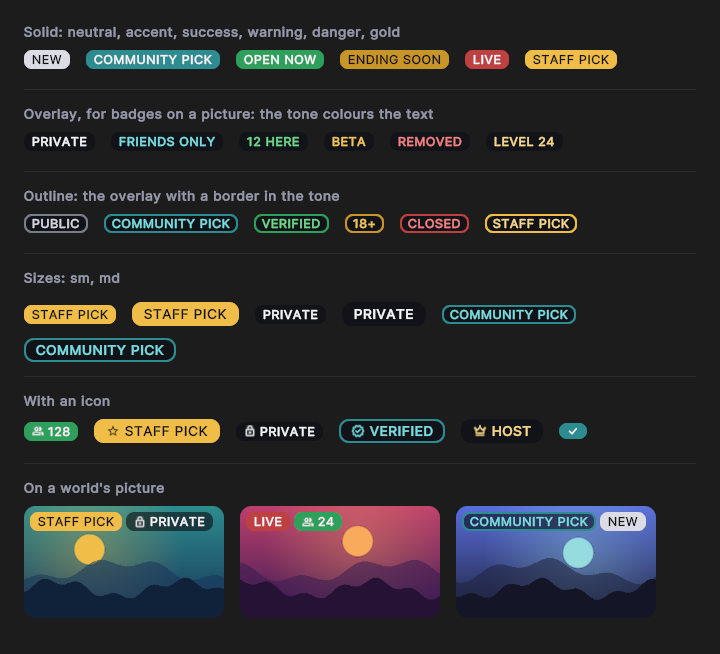

| Property | UXML attribute | Type | Default | What it does |
|---|---|---|---|---|
| `text` | `text` | text | — | The label. Write it in capitals for the menu's look. |
| `icon` | `icon` | text | — | Glyph name shown before the label; empty for none. |
| `tone` | `tone` | `neutral`, `accent`, `success`, `warning`, `danger`, `gold` | `neutral` | Colour role. A solid badge is filled with it (`neutral` is light with dark text); on an overlay or outline badge it colours the text. |
| `variant` | `variant` | `solid`, `overlay`, `outline` | `solid` | `solid` is filled with the tone, `overlay` is dark and see-through for use on pictures, `outline` is the overlay with a 2 px border in the tone. |
| `size` | `size` | `sm`, `md` | `sm` | `sm` has 12 px text, `md` has 13 px text and more padding. |

JavaScript: `BS.UIKitBadge`, element type 210.

```js
const badge = new BS.UIKitBadge(panel);
badge.text = "FRIENDS ONLY";
badge.tone = "accent";
badge.variant = "overlay";
```

UI Builder (UXML):

```xml
<BS.UIKit.KitBadge text="FRIENDS ONLY" tone="Accent" variant="Overlay" />
```

### KitAvatar

A round portrait with an optional presence dot, speaking ring and badge picture.

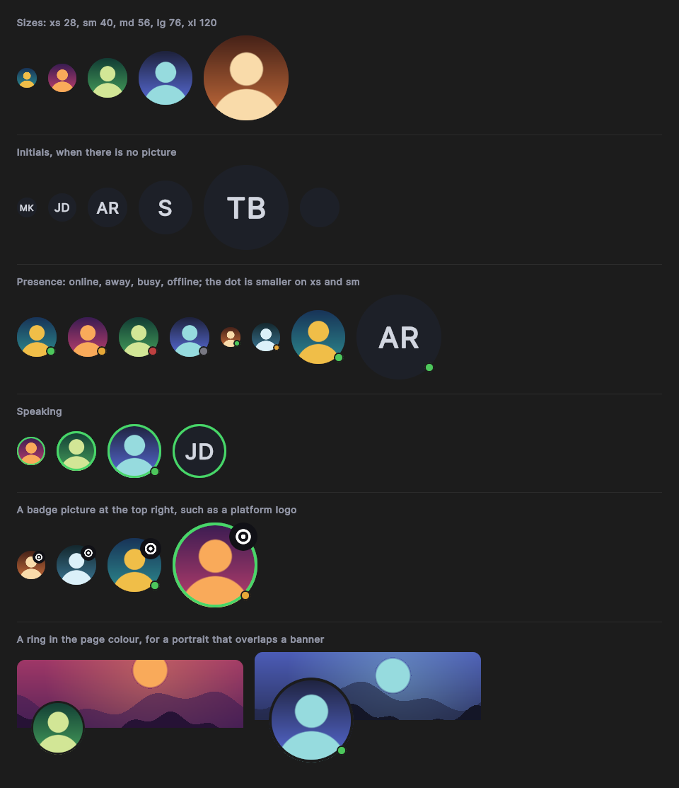

| Property | UXML attribute | Type | Default | What it does |
|---|---|---|---|---|
| `image` | `image` | picture | — | The portrait. It is cropped to a circle. |
| `initials` | `initials` | text | — | One or two characters shown when there is no picture. |
| `size` | `size` | `xs`, `sm`, `md`, `lg`, `xl` | `md` | Diameter: 28, 40, 56, 76 or 120 px. |
| `presence` | `presence` | `none`, `online`, `away`, `busy`, `offline` | `none` | Online state, shown as a dot at the bottom right. `none` shows no dot. |
| `speaking` | `speaking` | true / false | `false` | Show a green ring, for someone who is talking. |
| `ring` | `ring` | true / false | `false` | Show a ring in the page colour, for a portrait that overlaps a banner. |
| `badgeImage` | `badge-image` | picture | — | A small round badge at the top right, such as a platform logo. It sits on a dark disc, so use a light picture. |

JavaScript: `BS.UIKitAvatar`, element type 211.

```js
const avatar = new BS.UIKitAvatar(panel);
avatar.initials = "AR";
avatar.size = "xl";
avatar.presence = "online";
avatar.image = "https://example.com/picture.png";
```

UI Builder (UXML):

```xml
<BS.UIKit.KitAvatar initials="AR" size="Xl" presence="Online" />
```

### KitDivider

A 1px line between things, horizontal or vertical.

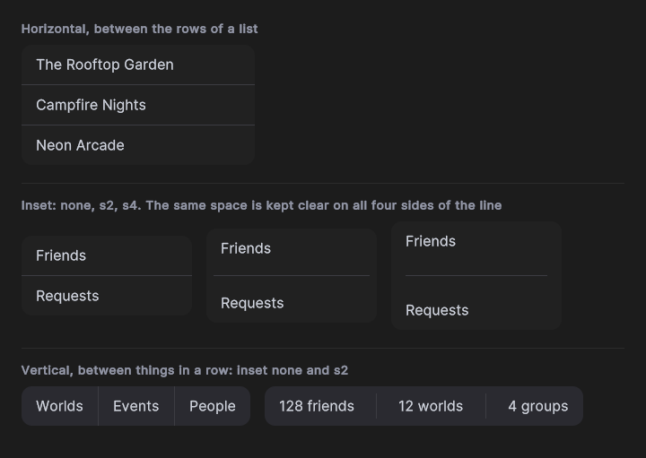

| Property | UXML attribute | Type | Default | What it does |
|---|---|---|---|---|
| `orientation` | `orientation` | `horizontal`, `vertical` | `horizontal` | `horizontal` for a line between things in a column, `vertical` for a line between things in a row. |
| `inset` | `inset` | `none`, `s1`, `s2`, `s3`, `s4`, `s5`, `s6` | `none` | Space kept clear on all four sides of the line, from the spacing scale: 0, 4, 8, 12, 16, 24 or 32 px. The line stops that far short of each end. |

JavaScript: `BS.UIKitDivider`, element type 212.

```js
const divider = new BS.UIKitDivider(panel);
divider.orientation = "vertical";
divider.inset = "s2";
```

UI Builder (UXML):

```xml
<BS.UIKit.KitDivider orientation="Vertical" inset="S2" />
```

### KitProgressBar

A bar that fills from the left, with an optional label.

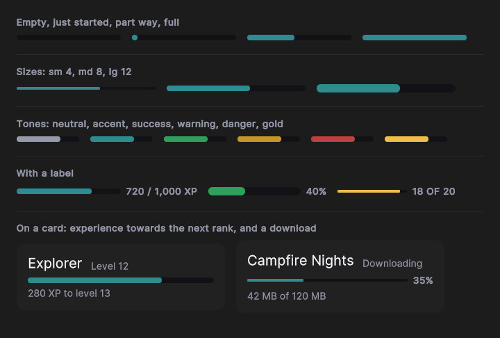

| Property | UXML attribute | Type | Default | What it does |
|---|---|---|---|---|
| `value` | `value` | number | `0` | How full the bar is, from 0 (empty) to 1 (full). |
| `tone` | `tone` | `neutral`, `accent`, `success`, `warning`, `danger`, `gold` | `accent` | Colour of the fill. |
| `size` | `size` | `sm`, `md`, `lg` | `md` | Height of the bar: 4, 8 or 12 px. |
| `label` | `label` | text | — | Text shown to the right of the bar, such as `40%`; empty for none. |

JavaScript: `BS.UIKitProgressBar`, element type 213.

```js
const progressBar = new BS.UIKitProgressBar(panel);
progressBar.value = 0.4;
progressBar.tone = "success";
progressBar.size = "lg";
progressBar.label = "40%";
```

UI Builder (UXML):

```xml
<BS.UIKit.KitProgressBar value="0.4" tone="Success" size="Lg" label="40%" />
```

### KitSpinner

A turning ring for work in progress.

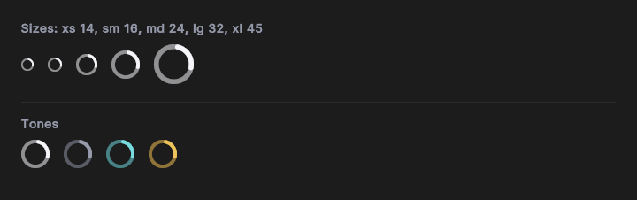

| Property | UXML attribute | Type | Default | What it does |
|---|---|---|---|---|
| `size` | `size` | `xs`, `sm`, `md`, `lg`, `xl` | `md` | Size step: 14, 16, 24, 32 or 45 px. |
| `tone` | `tone` | `default`, `secondary`, `muted`, `accent`, `success`, `warning`, `danger` | `default` | Colour role. |
| `paused` | `paused` | true / false | `false` | Stop turning (the ring stays visible). |

JavaScript: `BS.UIKitSpinner`, element type 214.

```js
const spinner = new BS.UIKitSpinner(panel);
spinner.size = "lg";
spinner.tone = "muted";
```

UI Builder (UXML):

```xml
<BS.UIKit.KitSpinner size="Lg" tone="Muted" />
```

### KitScrollView

A scroll view with a thin scrollbar.

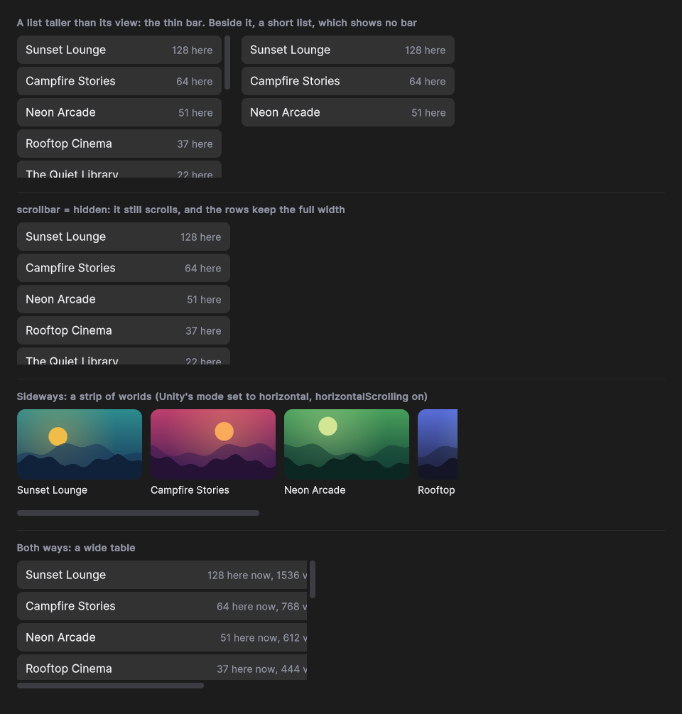

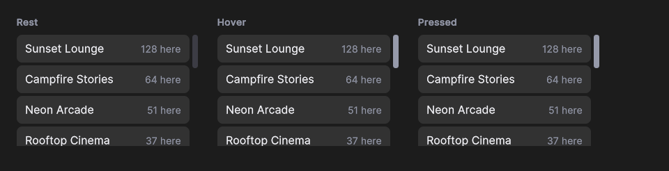

| Property | UXML attribute | Type | Default | What it does |
|---|---|---|---|---|
| `scrollbar` | `scrollbar` | `thin`, `hidden` | `thin` | `thin` is the menu's slim bar. `hidden` shows no bar and keeps no room for one; the content still scrolls. |
| `horizontalScrolling` | — | true / false | `false` | Show a scrollbar for scrolling sideways when the content is wider than the view. In the UI Builder this is Unity's `horizontal-scroller-visibility`: `Auto` or `Hidden`. |
| `verticalScrolling` | — | true / false | `true` | Show a scrollbar for scrolling up and down when the content is taller than the view. In the UI Builder this is Unity's `vertical-scroller-visibility`: `Auto` or `Hidden`. |

**Children:** Children scroll inside the view.

JavaScript: `BS.UIKitScrollView`, element type 215.

```js
const scrollView = new BS.UIKitScrollView(panel);
scrollView.horizontalScrolling = true;
scrollView.verticalScrolling = false;
scrollView.OnClick(() => console.log("scrollView pressed"));
```

UI Builder (UXML):

```xml
<BS.UIKit.KitScrollView />
```

### KitSurface

The container everything sits on: a background, a corner radius, padding and a direction.

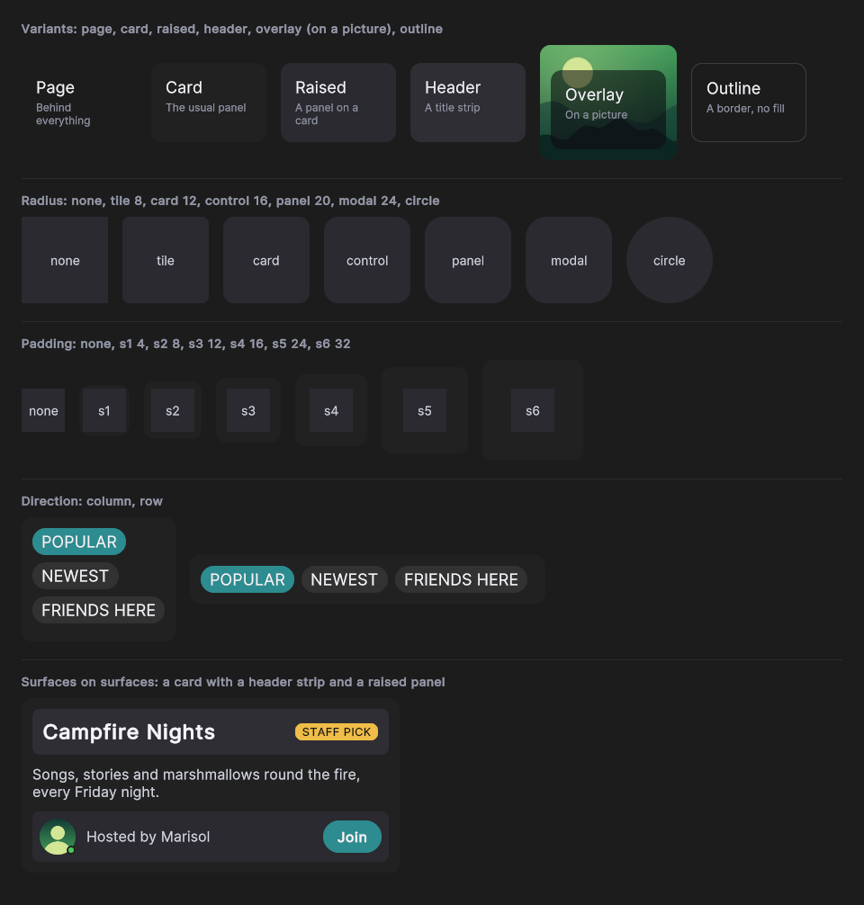

| Property | UXML attribute | Type | Default | What it does |
|---|---|---|---|---|
| `variant` | `variant` | `page`, `card`, `raised`, `header`, `overlay`, `outline` | `card` | The background: `page`, `card`, `raised` (a panel on a card), `header`, `overlay` (dark and see-through) or `outline` (no fill, a 1px border). |
| `radius` | `radius` | `none`, `tile`, `card`, `control`, `panel`, `modal`, `circle` | `card` | Corner radius step: 0, 8, 12, 16, 20 or 24 px, or `circle`. |
| `padding` | `padding` | `none`, `s1`, `s2`, `s3`, `s4`, `s5`, `s6` | `s4` | Padding step from the spacing scale: 0, 4, 8, 12, 16, 24 or 32 px. |
| `direction` | `direction` | `column`, `row` | `column` | Lay the children out in a `column` or in a `row`. |

**Children:** Children are added to the surface itself.

JavaScript: `BS.UIKitSurface`, element type 216.

```js
const surface = new BS.UIKitSurface(panel);
surface.variant = "raised";
surface.radius = "none";
surface.padding = "none";
```

UI Builder (UXML):

```xml
<BS.UIKit.KitSurface variant="Raised" radius="None" padding="None" />
```

<!-- kit:end atoms -->

## Molecules

<!-- kit:begin molecules -->

### KitSearchBar

A search pill: a glyph, a text field and a clear button that shows while there is text.

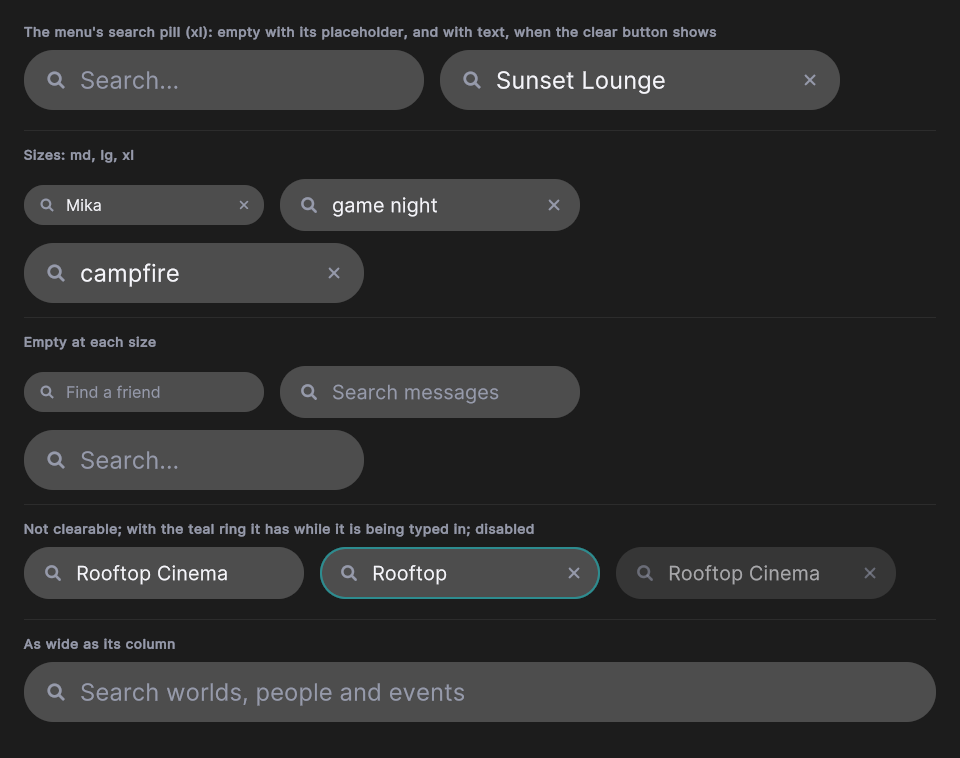

| Property | UXML attribute | Type | Default | What it does |
|---|---|---|---|---|
| `value` | `value` | text | — | The text. Setting it from a script raises no change event. Also accepted as `text`. |
| `placeholder` | `placeholder` | text | — | Quieter text shown while the field is empty, such as `Search...`. |
| `size` | `size` | `md`, `lg`, `xl` | `xl` | Height: `md` is 40 px, `lg` 52 px, `xl` 60 px (the menu's own). |
| `clearable` | `clearable` | true / false | `true` | Show a clear button while there is text. |

**Actions** (a change event whose `value` is the action's name): `search:submit`, `search:clear`

JavaScript: `BS.UIKitSearchBar`, element type 217.

```js
const searchBar = new BS.UIKitSearchBar(panel);
searchBar.value = "Mika";
searchBar.placeholder = "Find a friend";
searchBar.size = "md";
searchBar.OnChange((e) => { if (e.value === "search:submit") console.log("search:submit"); });
```

UI Builder (UXML):

```xml
<BS.UIKit.KitSearchBar value="Mika" placeholder="Find a friend" size="Md" />
```

### KitOptionRow

One row of a settings page: a label on the left, a control on the right. The control area is 55% of the row, so the controls of every row line up.

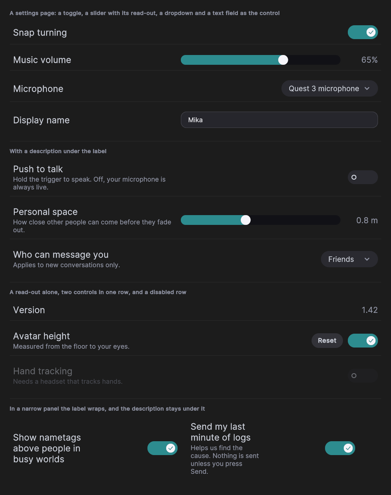

| Property | UXML attribute | Type | Default | What it does |
|---|---|---|---|---|
| `label` | `label` | text | — | What the option is, at the left of the row. |
| `description` | `description` | text | — | A smaller, quieter line under the label; empty for none. |
| `valueText` | `value-text` | text | — | A read-out at the far right, such as `65%`; empty for none. |
| `divider` | `divider` | true / false | `true` | Draw a thin line under the row. |

**Children:** The control area at the right of the row: a toggle, a slider, a dropdown.

JavaScript: `BS.UIKitOptionRow`, element type 218.

```js
const optionRow = new BS.UIKitOptionRow(panel);
optionRow.label = "Who can message you";
optionRow.description = "Applies to new conversations only.";
optionRow.divider = false;
```

UI Builder (UXML):

```xml
<BS.UIKit.KitOptionRow label="Who can message you" description="Applies to new conversations only." divider="false" />
```

### KitFormField

A labelled field in a form, with a counter and a line of help or an error message.

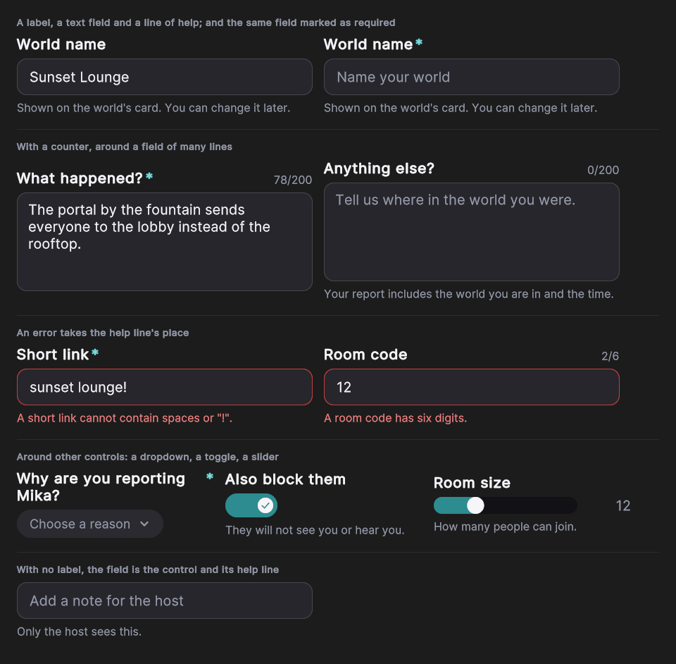

| Property | UXML attribute | Type | Default | What it does |
|---|---|---|---|---|
| `label` | `label` | text | — | What the field is for, above the control. |
| `counter` | `counter` | text | — | Quieter text at the right of the label, such as `12/200`; empty for none. |
| `required` | `required` | true / false | `false` | Mark the label with a teal star: the field must be filled in. |
| `help` | `help` | text | — | A quieter line under the control; empty for none. |
| `error` | `error` | text | — | What is wrong with the entry. While it is not empty it is shown in red in place of the help line. |

**Children:** The control, between the label and the help line.

JavaScript: `BS.UIKitFormField`, element type 219.

```js
const formField = new BS.UIKitFormField(panel);
formField.label = "What happened?";
formField.counter = "78/200";
formField.required = true;
```

UI Builder (UXML):

```xml
<BS.UIKit.KitFormField label="What happened?" counter="78/200" required="true" />
```

### KitTabs

A row of tabs with one selected, in three looks.

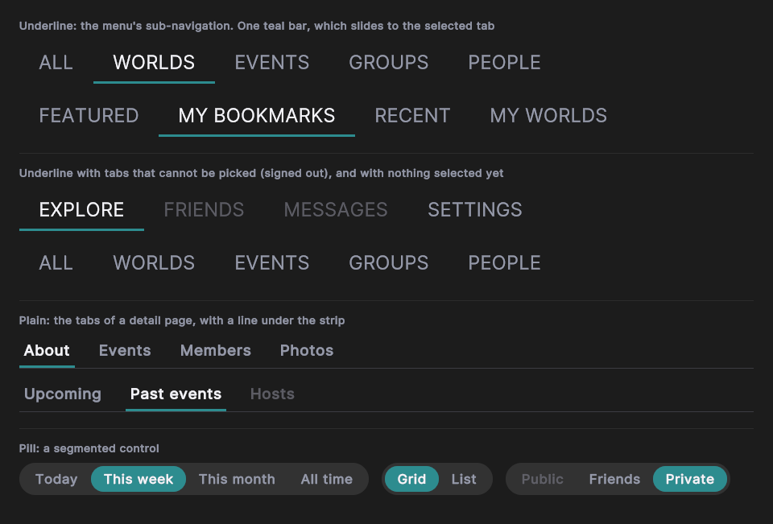

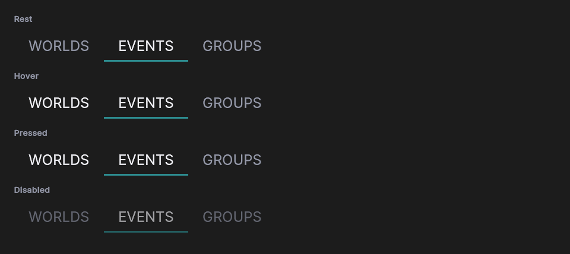

| Property | UXML attribute | Type | Default | What it does |
|---|---|---|---|---|
| `choices` | `choices` | list (`a;b;c`) | — | The tabs. An entry is `key:Text`, or just `Text` when the key is the text. An entry is cut at its first colon, so a text with a colon in it needs a key in front: `re:Re: hello`. |
| `value` | `value` | text | — | Key of the selected tab, or empty for none. Setting it from a script raises no change event. |
| `variant` | `variant` | `underline`, `plain`, `pill` | `underline` | The look: `underline` has one sliding teal bar, `plain` is smaller with a line under the strip, `pill` is a segmented control. |
| `disabledChoices` | `disabled-choices` | list (`a;b;c`) | — | Keys of the tabs the user cannot pick. |

JavaScript: `BS.UIKitTabs`, element type 220.

```js
const tabs = new BS.UIKitTabs(panel);
tabs.choices = "upcoming:Upcoming;past:Past events;hosts:Hosts";
tabs.value = "past";
tabs.variant = "plain";
tabs.disabledChoices = "hosts";
tabs.OnChange((e) => console.log(e.value));
```

UI Builder (UXML):

```xml
<BS.UIKit.KitTabs choices="upcoming:Upcoming;past:Past events;hosts:Hosts" value="past" variant="Plain" disabled-choices="hosts" />
```

### KitChipGroup

A labelled row of chips where one, or several, is selected.

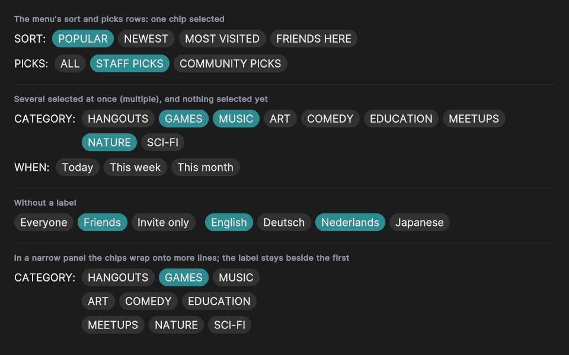

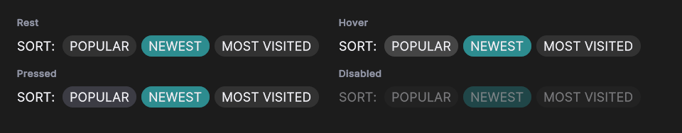

| Property | UXML attribute | Type | Default | What it does |
|---|---|---|---|---|
| `label` | `label` | text | — | Text at the left of the chips, such as `SORT:`; empty for none. |
| `choices` | `choices` | list (`a;b;c`) | — | The chips. An entry is `key:Text`, or just `Text` when the key is the text. An entry is cut at its first colon, so a text with a colon in it needs a key in front: `re:Re: hello`. |
| `value` | `value` | text | — | Key of the selected chip, or with `multiple` the selected keys with `;` between them. Setting it from a script raises no change event. |
| `multiple` | `multiple` | true / false | `false` | Let several chips be selected at once: a press switches a chip on or off. Without it, picking a chip deselects the others. |

JavaScript: `BS.UIKitChipGroup`, element type 221.

```js
const chipGroup = new BS.UIKitChipGroup(panel);
chipGroup.choices = "en:English;de:Deutsch;nl:Nederlands;ja:Japanese";
chipGroup.value = "en;nl";
chipGroup.multiple = true;
chipGroup.OnChange((e) => console.log(e.value));
```

UI Builder (UXML):

```xml
<BS.UIKit.KitChipGroup choices="en:English;de:Deutsch;nl:Nederlands;ja:Japanese" value="en;nl" multiple="true" />
```

### KitCountPill

A glyph and a number in a pill, for votes and for people present.

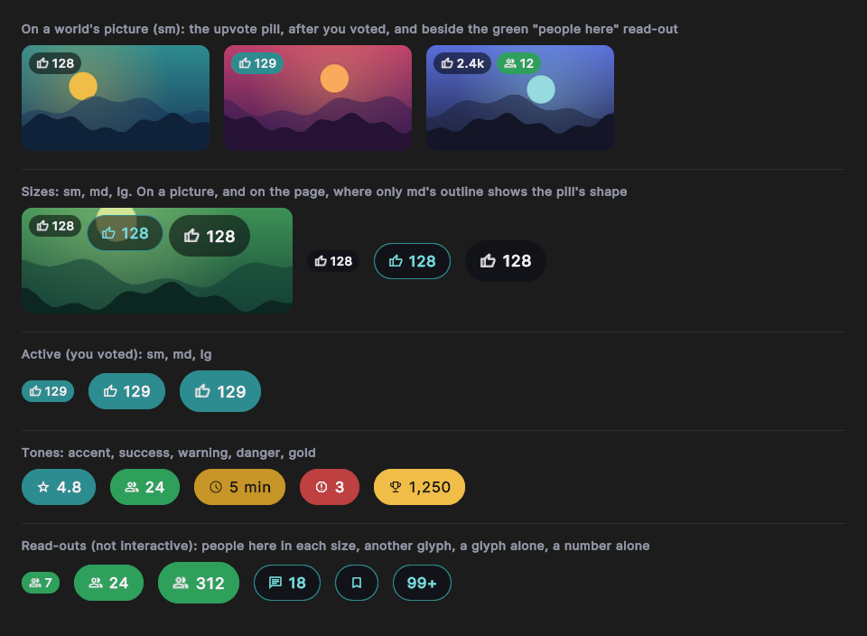

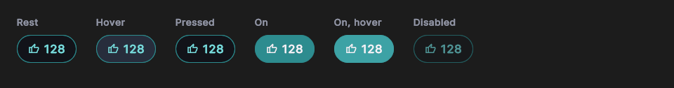

| Property | UXML attribute | Type | Default | What it does |
|---|---|---|---|---|
| `icon` | `icon` | text | `thumb-up` | Glyph name shown before the count, such as `thumb-up` or `group`; empty for none. |
| `count` | `count` | text | — | The number, as text: `128`, `1.2k`. |
| `active` | `active` | true / false | `false` | Show as switched on (filled teal), for "you voted". A press does not change it: set it when you handle the click. |
| `tone` | `tone` | `neutral`, `accent`, `success`, `warning`, `danger`, `gold` | `neutral` | Colour role. `neutral` is the dark see-through pill, `success` the green "people here" pill; the others fill with their colour. |
| `size` | `size` | `sm`, `md`, `lg` | `md` | `sm` is the 24 px pill on a card, `md` is 40 px with a teal outline, `lg` is 46 px. |
| `interactive` | `interactive` | true / false | `true` | Can be pressed, with hover and pressed looks. Off, it is a plain read-out and a press goes to whatever is behind it. |

JavaScript: `BS.UIKitCountPill`, element type 222.

```js
const countPill = new BS.UIKitCountPill(panel);
countPill.count = "129";
countPill.active = true;
countPill.size = "sm";
countPill.OnClick(() => console.log("countPill pressed"));
```

UI Builder (UXML):

```xml
<BS.UIKit.KitCountPill count="129" active="true" size="Sm" />
```

### KitStat

A small glyph with a value, such as "24 here" or "72 fps".

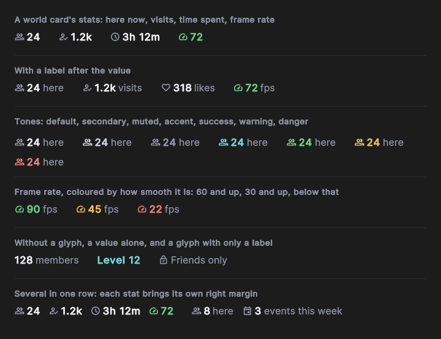

| Property | UXML attribute | Type | Default | What it does |
|---|---|---|---|---|
| `icon` | `icon` | text | — | Glyph name shown before the value, such as `group` or `speed`; empty for none. |
| `value` | `value` | text | — | The number or short text, in bold: `24`, `1.2k`, `72`. |
| `label` | `label` | text | — | Quieter text after the value, such as `here` or `fps`; empty for none. |
| `tone` | `tone` | `default`, `secondary`, `muted`, `accent`, `success`, `warning`, `danger` | `default` | Colour role for the value and the glyph. `default` keeps the value near-white and the glyph muted. |

JavaScript: `BS.UIKitStat`, element type 223.

```js
const stat = new BS.UIKitStat(panel);
stat.icon = "speed";
stat.value = "72";
stat.tone = "success";
```

UI Builder (UXML):

```xml
<BS.UIKit.KitStat icon="speed" value="72" tone="Success" />
```

### KitListRow

One row of a list: a picture or a glyph, a title, a quieter line under it, and room at the right for a button or a badge.

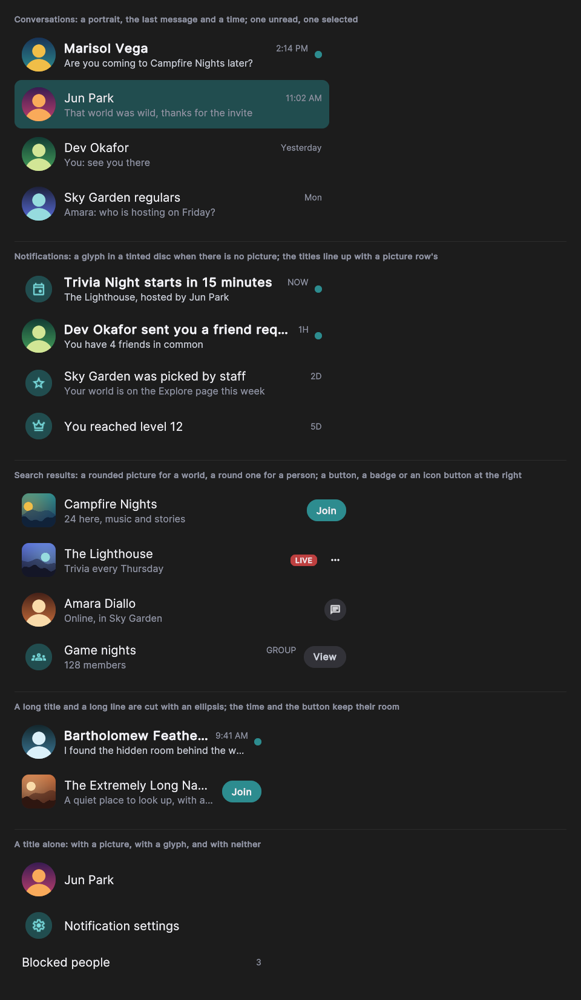

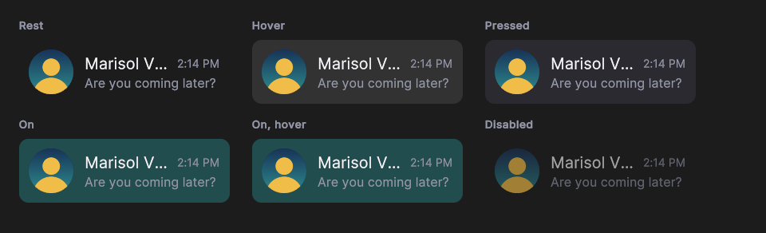

| Property | UXML attribute | Type | Default | What it does |
|---|---|---|---|---|
| `title` | `title` | text | — | The main line. |
| `subtitle` | `subtitle` | text | — | One quieter line under the title, cut with an ellipsis when it does not fit; empty for none. |
| `meta` | `meta` | text | — | Small text at the top right, such as a time; empty for none. |
| `icon` | `icon` | text | — | Glyph name shown in a round tinted disc at the left, used when there is no picture; empty for none. |
| `image` | `image` | picture | — | The picture at the left: a portrait or a thumbnail. It takes the place of the glyph. |
| `imageShape` | `image-shape` | `circle`, `rounded` | `circle` | `circle` for a person, `rounded` for a world or a group. |
| `selected` | `selected` | true / false | `false` | Show as the chosen row. A press does not change it: set it when you handle the click. |
| `unread` | `unread` | true / false | `false` | Show as not yet read: a bold title and an accent dot. |

**Children:** Children go at the right end of the row.

JavaScript: `BS.UIKitListRow`, element type 224.

```js
const listRow = new BS.UIKitListRow(panel);
listRow.title = "Marisol Vega";
listRow.subtitle = "Are you coming to Campfire Nights later?";
listRow.meta = "2:14 PM";
listRow.unread = true;
listRow.image = "https://example.com/picture.png";
listRow.OnClick(() => console.log("listRow pressed"));
```

UI Builder (UXML):

```xml
<BS.UIKit.KitListRow title="Marisol Vega" subtitle="Are you coming to Campfire Nights later?" meta="2:14 PM" unread="true" />
```

### KitMessageBubble

One chat message: incoming on a grey bubble at the left, outgoing on a teal bubble at the right.

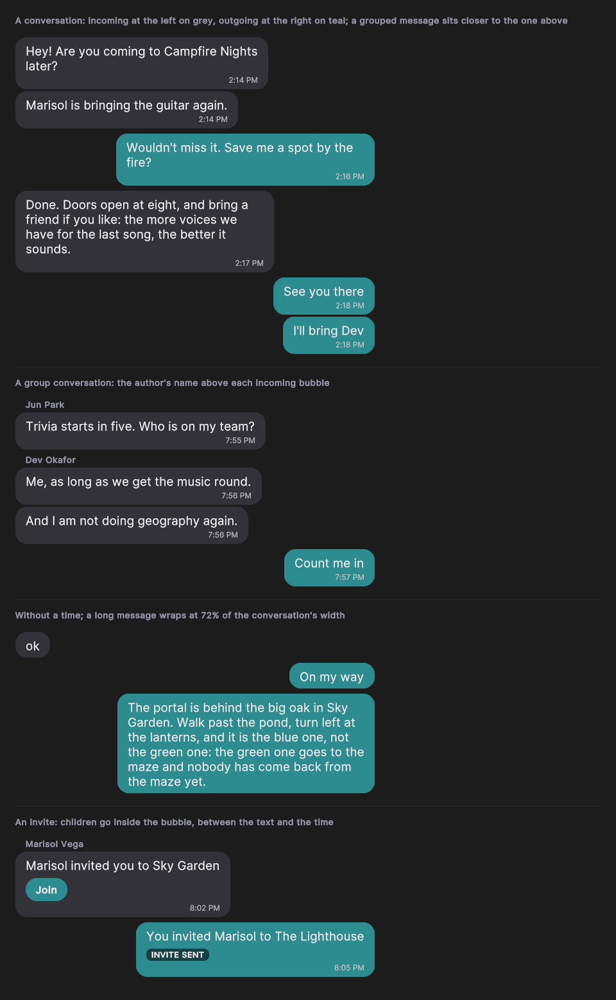

| Property | UXML attribute | Type | Default | What it does |
|---|---|---|---|---|
| `text` | `text` | text | — | The message. It wraps. |
| `side` | `side` | `incoming`, `outgoing` | `incoming` | `incoming` sits at the left on a grey bubble, `outgoing` at the right on a teal one. |
| `author` | `author` | text | — | A small name above an incoming bubble, for a conversation with several people; empty for none. |
| `time` | `time` | text | — | Small quieter text at the bottom right inside the bubble, such as `2:14 PM`; empty for none. |
| `grouped` | `grouped` | true / false | `false` | Sit closer to the message above, for a message that follows one from the same person. |

**Children:** Children go inside the bubble, under the text.

JavaScript: `BS.UIKitMessageBubble`, element type 225.

```js
const messageBubble = new BS.UIKitMessageBubble(panel);
messageBubble.text = "Trivia starts in five. Who is on my team?";
messageBubble.author = "Jun Park";
messageBubble.time = "7:55 PM";
```

UI Builder (UXML):

```xml
<BS.UIKit.KitMessageBubble text="Trivia starts in five. Who is on my team?" author="Jun Park" time="7:55 PM" />
```

### KitNavItem

One entry of the main navigation bar: a big glyph over a label, with an optional count.

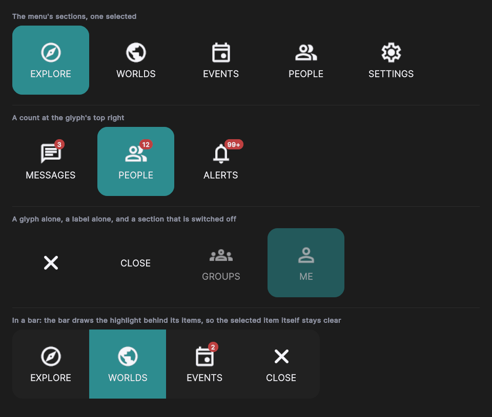

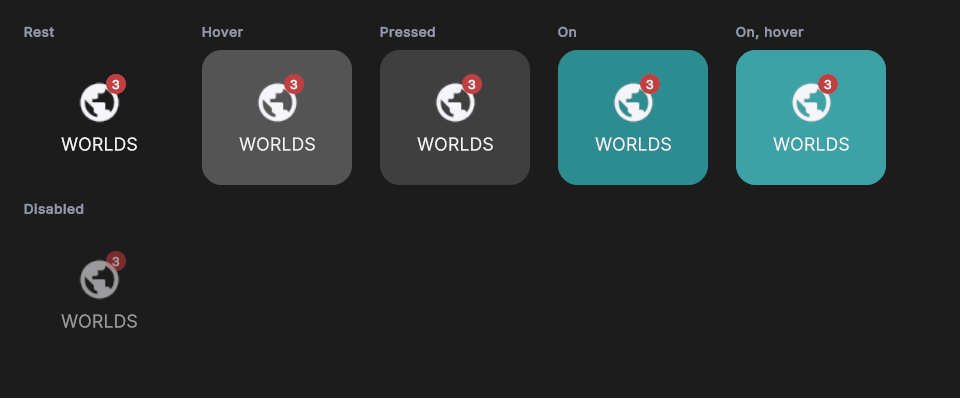

| Property | UXML attribute | Type | Default | What it does |
|---|---|---|---|---|
| `key` | `key` | text | — | The value a KitNavBar reports when this item is picked. When empty, the text is the key. |
| `text` | `text` | text | — | The label under the glyph. Write it in capitals for the menu's look. |
| `icon` | `icon` | text | — | Glyph name shown above the label, such as `explore` or `worlds`; empty for none. |
| `selected` | `selected` | true / false | `false` | Show as the current section (teal). A press does not change it: set it when you handle the click. |
| `badge` | `badge` | text | — | A small count at the glyph's top right, such as `3`; empty for none. |

JavaScript: `BS.UIKitNavItem`, element type 226.

```js
const navItem = new BS.UIKitNavItem(panel);
navItem.key = "explore";
navItem.text = "EXPLORE";
navItem.icon = "explore";
navItem.selected = true;
navItem.OnClick(() => console.log("navItem pressed"));
```

UI Builder (UXML):

```xml
<BS.UIKit.KitNavItem key="explore" text="EXPLORE" icon="explore" selected="true" />
```

### KitEmptyState

What a list shows when it has nothing: a big quiet glyph, a title, a line of explanation and optional actions.

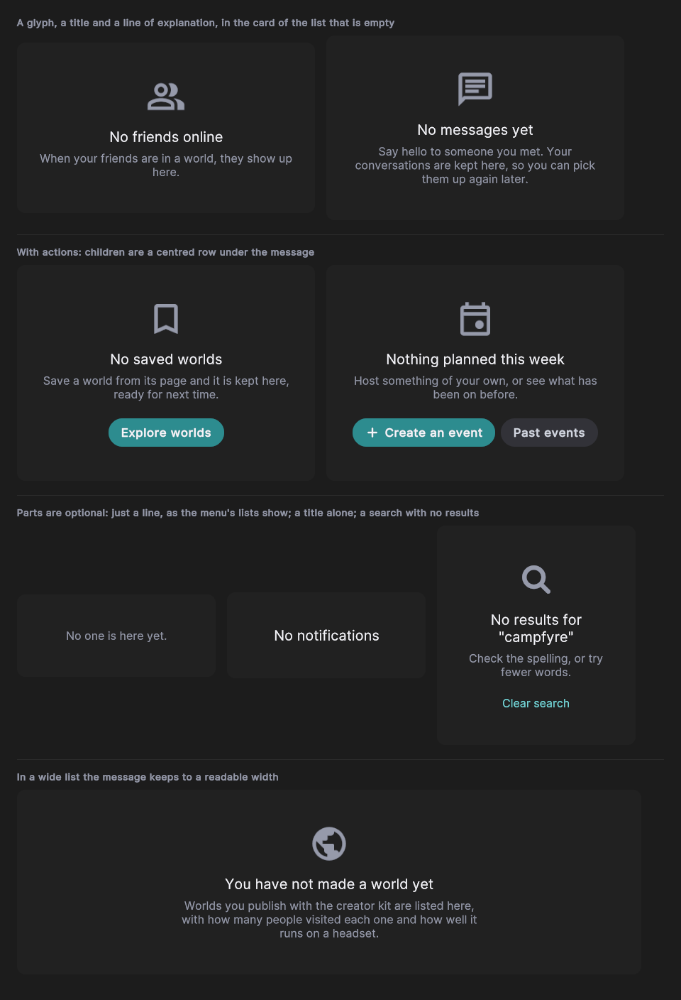

| Property | UXML attribute | Type | Default | What it does |
|---|---|---|---|---|
| `icon` | `icon` | text | — | Glyph name shown large above the title, such as `group` or `chat`; empty for none. |
| `title` | `title` | text | — | The headline, such as `No friends online`. |
| `message` | `message` | text | — | A line or two of explanation under the title. It wraps. |

**Children:** Children are the actions: a centred row under the message.

JavaScript: `BS.UIKitEmptyState`, element type 227.

```js
const emptyState = new BS.UIKitEmptyState(panel);
emptyState.icon = "search";
emptyState.title = "No results for \"campfyre\"";
emptyState.message = "Check the spelling, or try fewer words.";
```

UI Builder (UXML):

```xml
<BS.UIKit.KitEmptyState icon="search" title="No results for &quot;campfyre&quot;" message="Check the spelling, or try fewer words." />
```

### KitSectionHeader

The heading above a strip or a grid: an optional eyebrow, a title, an optional count and an optional link at the right.

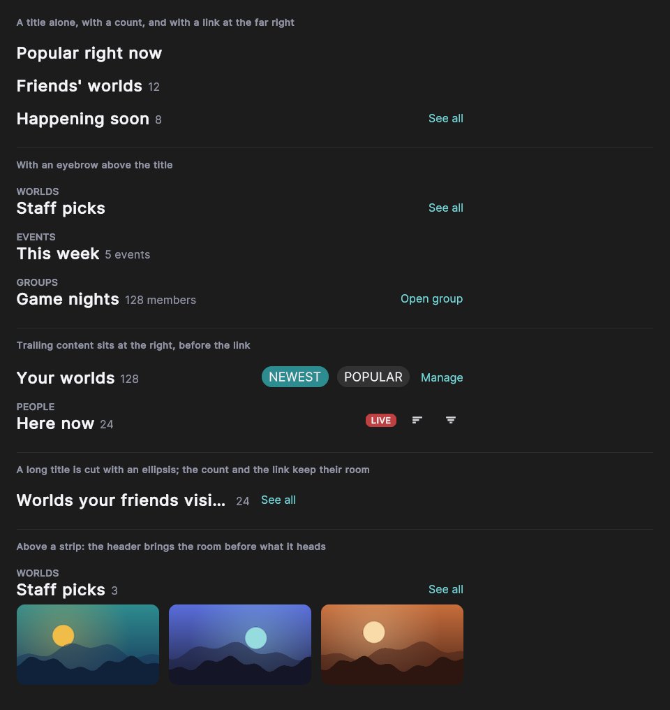

| Property | UXML attribute | Type | Default | What it does |
|---|---|---|---|---|
| `eyebrow` | `eyebrow` | text | — | Small bold text above the title, such as `WORLDS`. Write it in capitals; empty for none. |
| `title` | `title` | text | — | The heading. |
| `count` | `count` | text | — | Quieter text after the title, such as a number of results; empty for none. |
| `actionText` | `action-text` | text | — | The label of a link at the far right, such as `See all`; empty for no link. Pressing it reports `header:action`. |

**Children:** Children go at the right, before the link.

**Actions** (a change event whose `value` is the action's name): `header:action`

JavaScript: `BS.UIKitSectionHeader`, element type 228.

```js
const sectionHeader = new BS.UIKitSectionHeader(panel);
sectionHeader.eyebrow = "WORLDS";
sectionHeader.title = "Staff picks";
sectionHeader.actionText = "See all";
sectionHeader.OnChange((e) => { if (e.value === "header:action") console.log("header:action"); });
```

UI Builder (UXML):

```xml
<BS.UIKit.KitSectionHeader eyebrow="WORLDS" title="Staff picks" action-text="See all" />
```

<!-- kit:end molecules -->

## Organisms

<!-- kit:begin organisms -->

### KitCard

A grid card: a picture with badges and pills over it, a title, a quieter line, stats and a button.

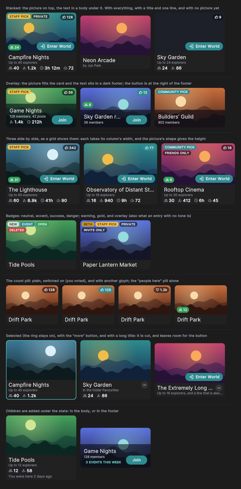

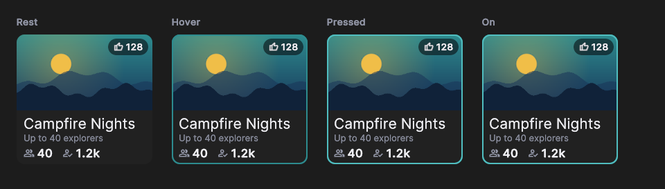

| Property | UXML attribute | Type | Default | What it does |
|---|---|---|---|---|
| `variant` | `variant` | `stacked`, `overlay` | `stacked` | `stacked` has the picture on top and the text in a body under it; `overlay` lets the picture fill the card, with the text in a dark footer over its bottom edge. |
| `image` | `image` | picture | — | The picture, kept at 16:9. Until one is set the card shows a dark placeholder colour. |
| `title` | `title` | text | — | The main line, cut with an ellipsis when it does not fit. |
| `subtitle` | `subtitle` | text | — | One quieter line under the title; empty for none. |
| `badges` | `badges` | list (`a;b;c`) | — | Up to four badges at the top left of the picture. An entry is `tone:Text`, such as `gold:STAFF PICK;overlay:PRIVATE`. Tones are `neutral`, `accent`, `success`, `warning`, `danger`, `gold` and `overlay` (dark and see-through); an entry with no tone is `overlay`. |
| `count` | `count` | text | — | The number in a pill at the top right of the picture, such as a number of votes; empty for no pill. Pressing the pill reports `card:count`. |
| `countIcon` | `count-icon` | text | `thumb-up` | Glyph name shown before the count; empty for none. |
| `countActive` | `count-active` | true / false | `false` | Show the count pill as switched on (teal), for "you voted". A press does not change it: set it when you handle `card:count`. |
| `liveCount` | `live-count` | text | — | The number in a green "people here" pill at the bottom left of the picture; empty for no pill. |
| `actionText` | `action-text` | text | — | The label of the card's button, such as `Join`. With no label and no icon there is no button. Pressing it reports `card:action`. |
| `actionIcon` | `action-icon` | text | — | Glyph name shown on the card's button; empty for none. |
| `stats` | `stats` | list (`a;b;c`) | — | Up to six small stats under the text. An entry is `icon:Text`, such as `group:24;schedule:3h 12m`, or just `Text` for a stat with no glyph. |
| `selected` | `selected` | true / false | `false` | Keep the teal ring on. A press does not change it: set it when you handle the click. |
| `menu` | `menu` | true / false | `false` | Show a small "more" button beside the title. Pressing it reports `card:menu`. |

**Children:** Children go under the stats: at the end of the body, or of the footer over the picture.

**Actions** (a change event whose `value` is the action's name): `card:action`, `card:count`, `card:menu`

JavaScript: `BS.UIKitCard`, element type 229.

```js
const card = new BS.UIKitCard(panel);
card.title = "Sky Garden";
card.subtitle = "Up to 24 explorers";
card.count = "9";
card.actionText = "Enter World";
card.actionIcon = "login";
card.stats = "group:24;how-to-reg:86";
card.image = "https://example.com/picture.png";
card.OnClick(() => console.log("card pressed"));
card.OnChange((e) => { if (e.value === "card:action") console.log("card:action"); });
```

UI Builder (UXML):

```xml
<BS.UIKit.KitCard title="Sky Garden" subtitle="Up to 24 explorers" count="9" action-text="Enter World" action-icon="login" stats="group:24;how-to-reg:86" />
```

### KitEventCard

A row card for something with a date: the day and month, a picture, a title with a time and a host, and badges and pills at the right.

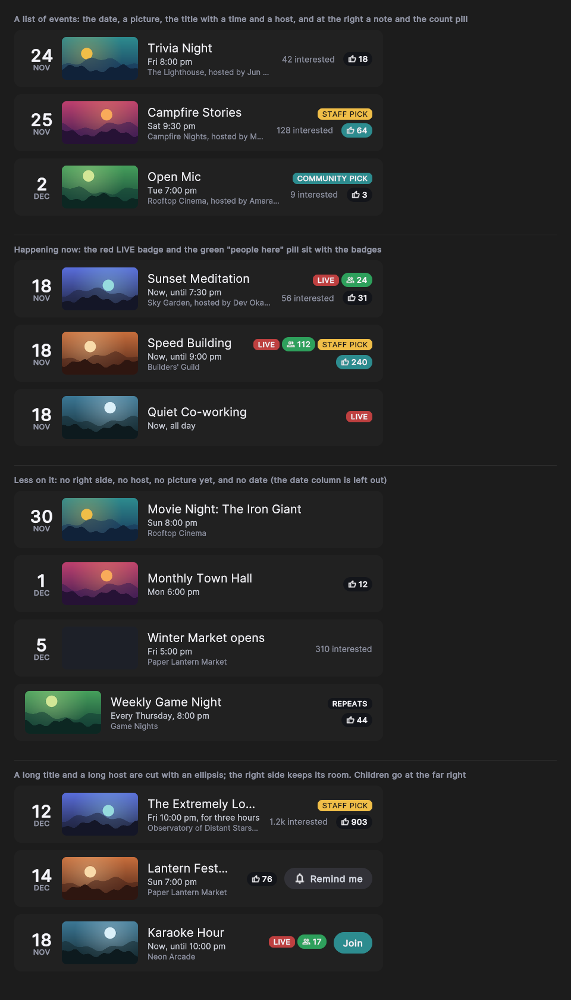

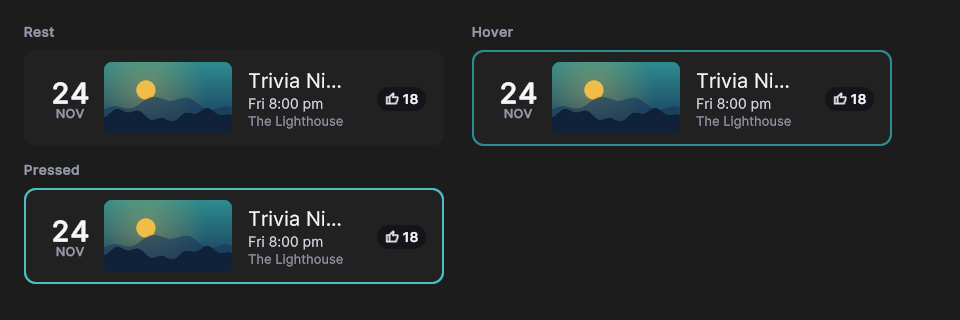

| Property | UXML attribute | Type | Default | What it does |
|---|---|---|---|---|
| `day` | `day` | text | — | The day of the month, in large bold text at the left: `24`. |
| `month` | `month` | text | — | The month under the day, small and bold: `NOV`. Write it in capitals. With no day and no month the date column is left out. |
| `image` | `image` | picture | — | The picture: 128 by 72 px. Until one is set the card shows a dark placeholder colour. |
| `title` | `title` | text | — | The main line, cut with an ellipsis when it does not fit. |
| `time` | `time` | text | — | When it is, under the title: `Fri 8:00 pm`; empty for none. |
| `host` | `host` | text | — | Who or where, on a third and quieter line: `Hosted by Jun Park`; empty for none. |
| `badges` | `badges` | list (`a;b;c`) | — | Up to four badges at the top right. An entry is `tone:Text`, such as `gold:STAFF PICK`. Tones are `neutral`, `accent`, `success`, `warning`, `danger`, `gold` and `overlay` (dark and see-through); an entry with no tone is `overlay`. |
| `live` | `live` | true / false | `false` | Show a red LIVE badge before the other badges, for something happening now. |
| `liveCount` | `live-count` | text | — | The number in a green "people here" pill beside the badges; empty for no pill. |
| `interested` | `interested` | text | — | A quiet note at the bottom right, such as `42 interested`; empty for none. |
| `count` | `count` | text | — | The number in a pill at the bottom right, such as a number of votes; empty for no pill. Pressing the pill reports `event:count`. |
| `countActive` | `count-active` | true / false | `false` | Show the count pill as switched on (teal), for "you voted". A press does not change it: set it when you handle `event:count`. |

**Children:** Children go at the far right of the row.

**Actions** (a change event whose `value` is the action's name): `event:count`

JavaScript: `BS.UIKitEventCard`, element type 230.

```js
const eventCard = new BS.UIKitEventCard(panel);
eventCard.day = "24";
eventCard.month = "NOV";
eventCard.title = "Trivia Night";
eventCard.time = "Fri 8:00 pm";
eventCard.host = "The Lighthouse, hosted by Jun Park";
eventCard.interested = "42 interested";
eventCard.count = "18";
eventCard.image = "https://example.com/picture.png";
eventCard.OnClick(() => console.log("eventCard pressed"));
eventCard.OnChange((e) => { if (e.value === "event:count") console.log("event:count"); });
```

UI Builder (UXML):

```xml
<BS.UIKit.KitEventCard day="24" month="NOV" title="Trivia Night" time="Fri 8:00 pm" host="The Lighthouse, hosted by Jun Park" interested="42 interested" count="18" />
```

### KitPersonCard

A person: a round portrait, a name, up to two quieter lines and status glyphs, as a pill, a compact row or a moderator's row.

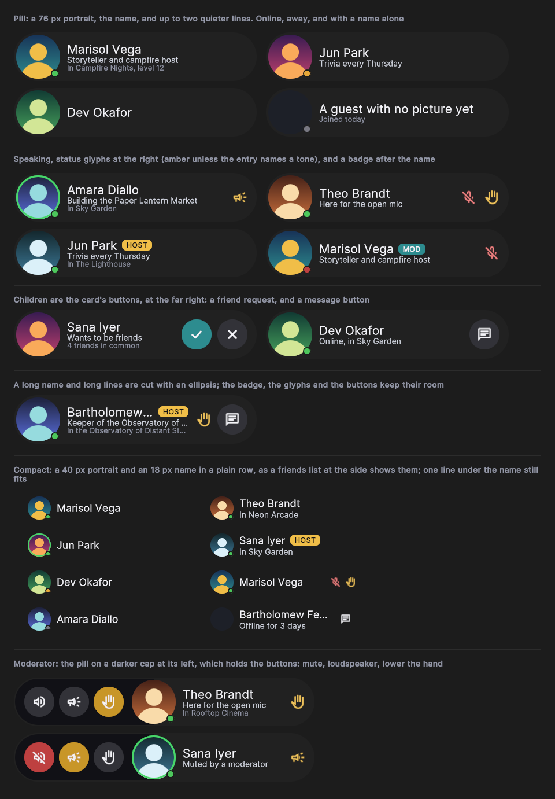

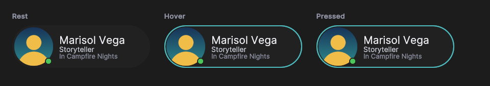

| Property | UXML attribute | Type | Default | What it does |
|---|---|---|---|---|
| `variant` | `variant` | `pill`, `compact`, `moderator` | `pill` | `pill` is the 84 px pill with a large portrait; `compact` is a small plain row with a 40 px portrait; `moderator` is the pill on a darker cap at its left, which holds the buttons you add. |
| `image` | `image` | picture | — | The portrait. It is cropped to a circle. |
| `title` | `title` | text | — | The person's name, cut with an ellipsis when it does not fit. |
| `subtitle` | `subtitle` | text | — | One quieter line under the name, such as a tag line; empty for none. |
| `meta` | `meta` | text | — | A third, smaller line, such as where they are; empty for none. A compact card does not show it. |
| `presence` | `presence` | `none`, `online`, `away`, `busy`, `offline` | `none` | Online state, shown as a dot on the portrait. `none` shows no dot. |
| `speaking` | `speaking` | true / false | `false` | Show a green ring on the portrait, for someone who is talking. |
| `status` | `status` | list (`a;b;c`) | — | Up to four glyphs at the right, such as `mic-off;back-hand`. An entry is a glyph name, or `tone:glyph` to colour it: `danger:mic-off`. Tones are `default`, `secondary`, `muted`, `accent`, `success`, `warning` and `danger`; with no tone a glyph is amber (`warning`). |
| `badge` | `badge` | text | — | The text of a small badge after the name, such as `HOST`; empty for none. |
| `badgeTone` | `badge-tone` | `neutral`, `accent`, `success`, `warning`, `danger`, `gold` | `neutral` | Colour role of the badge after the name. |

**Children:** Children are the card's buttons: at the far right, or in the darker cap at the left of a moderator card.

JavaScript: `BS.UIKitPersonCard`, element type 231.

```js
const personCard = new BS.UIKitPersonCard(panel);
personCard.title = "Marisol Vega";
personCard.subtitle = "Storyteller and campfire host";
personCard.meta = "In Campfire Nights, level 12";
personCard.presence = "online";
personCard.image = "https://example.com/picture.png";
personCard.OnClick(() => console.log("personCard pressed"));
```

UI Builder (UXML):

```xml
<BS.UIKit.KitPersonCard title="Marisol Vega" subtitle="Storyteller and campfire host" meta="In Campfire Nights, level 12" presence="Online" />
```

### KitHeroBanner

The big banner at the top of a page: a picture with a title, a line of detail and actions over it.


| Property | UXML attribute | Type | Default | What it does |
|---|---|---|---|---|
| `image` | `image` | picture | — | The banner picture. Until one is set the banner shows a dark placeholder colour. |
| `eyebrow` | `eyebrow` | text | — | A small badge at the banner's top left, such as `LIVE NOW`. Write it in capitals; empty for none. |
| `eyebrowTone` | `eyebrow-tone` | `neutral`, `accent`, `success`, `warning`, `danger`, `gold` | `danger` | Colour role of the badge. |
| `title` | `title` | text | — | The headline, in 40 px text on one line. |
| `meta` | `meta` | text | — | One quieter line under the title, such as a time and a place; empty for none. |
| `size` | `size` | `md`, `lg` | `lg` | Height of the banner: `md` is 240 px, `lg` is 360 px. |

**Children:** Children are the actions: a row under the meta line.

JavaScript: `BS.UIKitHeroBanner`, element type 232.

```js
const heroBanner = new BS.UIKitHeroBanner(panel);
heroBanner.eyebrow = "LIVE NOW";
heroBanner.title = "Friday Night Campfire";
heroBanner.meta = "Started at 8:00 PM in Campfire Nights";
heroBanner.image = "https://example.com/picture.png";
```

UI Builder (UXML):

```xml
<BS.UIKit.KitHeroBanner eyebrow="LIVE NOW" title="Friday Night Campfire" meta="Started at 8:00 PM in Campfire Nights" />
```

### KitDetailHeader

The top of a detail page: a banner picture, then a card with the name, badges, a line of detail, stats and actions.


| Property | UXML attribute | Type | Default | What it does |
|---|---|---|---|---|
| `image` | `image` | picture | — | The banner picture. Until one is set the banner shows a dark placeholder colour. |
| `eyebrow` | `eyebrow` | text | — | Small bold text above the title, such as `WORLD`. Write it in capitals; empty for none. |
| `title` | `title` | text | — | The name, in 34 px text. It wraps. |
| `badges` | `badges` | list (`a;b;c`) | — | Up to six badges under the title, such as `gold:STAFF PICK;danger:LIVE;PART OF A SERIES`. An entry is `tone:Text`, where the tone is `neutral`, `accent`, `success`, `warning`, `danger` or `gold` for a filled badge, or `overlay` for the dark see-through one. An entry with no tone is `overlay`. |
| `meta` | `meta` | text | — | One quieter line, such as who made it or when it starts; empty for none. |
| `stats` | `stats` | list (`a;b;c`) | — | Up to eight stats in a row, such as `group:24 here;schedule:3h 12m;speed:72 fps`. An entry is `icon:Text`, where the icon is a glyph name; an entry with no icon is the text alone. |

**Children:** Children are the actions: a row at the bottom of the card.

JavaScript: `BS.UIKitDetailHeader`, element type 233.

```js
const detailHeader = new BS.UIKitDetailHeader(panel);
detailHeader.eyebrow = "EVENT";
detailHeader.title = "Friday Night Campfire";
detailHeader.badges = "danger:LIVE NOW;PART OF A SERIES";
detailHeader.meta = "Today, 8:00 PM to 10:00 PM";
detailHeader.stats = "star:42 interested;how-to-reg:18 attended";
detailHeader.image = "https://example.com/picture.png";
```

UI Builder (UXML):

```xml
<BS.UIKit.KitDetailHeader eyebrow="EVENT" title="Friday Night Campfire" badges="danger:LIVE NOW;PART OF A SERIES" meta="Today, 8:00 PM to 10:00 PM" stats="star:42 interested;how-to-reg:18 attended" />
```

### KitModal

A window over the page: a dim layer and a centred window with a title, a close button, a body and two buttons.


| Property | UXML attribute | Type | Default | What it does |
|---|---|---|---|---|
| `open` | `open` | true / false | `true` | Whether the modal is showing. Closed, it takes no room and no presses. It closes itself when the user dismisses it. |
| `title` | `title` | text | — | The heading at the top of the window, in 30 px bold text. |
| `message` | `message` | text | — | Text at the top of the body, in 22 px. It wraps; empty for none. |
| `variant` | `variant` | `standard`, `chromeless`, `wide` | `standard` | `standard` is a 560 px window with a title bar and padding. `chromeless` has neither: its content fills the window, gives it its width, and the close button floats at the top right. `wide` is the standard window at 1100 px. |
| `showClose` | `show-close` | true / false | `true` | Show the round close button at the top right. |
| `primaryText` | `primary-text` | text | — | The label of the main button at the bottom right, such as `Save`; empty for no button. Pressing it reports `modal:primary`. |
| `secondaryText` | `secondary-text` | text | — | The label of the quieter button to its left, such as `Cancel`; empty for no button. Pressing it reports `modal:secondary`. |
| `primaryVariant` | `primary-variant` | `primary`, `secondary`, `outline`, `ghost`, `danger`, `warning`, `link` | `primary` | The look of the main button, such as `danger` for `Delete`. |
| `scrim` | `scrim` | true / false | `true` | Darken the page behind the window. Off, the page stays as bright but still cannot be pressed. |
| `dismissOnScrim` | `dismiss-on-scrim` | true / false | `true` | Close when the user presses outside the window. |

**Children:** Children are the body of the window, under the message. Tall content scrolls. The window is 560 px wide (1100 px when `wide`), or as wide as the panel allows when that is less; a `chromeless` window takes the width of its content, so give that content a width.

**Actions** (a change event whose `value` is the action's name): `modal:close`, `modal:primary`, `modal:secondary`

JavaScript: `BS.UIKitModal`, element type 234.

```js
const modal = new BS.UIKitModal(panel);
modal.title = "Leave Campfire Nights?";
modal.message = "You will go back to your home world.";
modal.primaryText = "Leave";
modal.secondaryText = "Stay";
modal.OnChange((e) => { if (e.value === "modal:close") console.log("modal:close"); });
```

UI Builder (UXML):

```xml
<BS.UIKit.KitModal title="Leave Campfire Nights?" message="You will go back to your home world." primary-text="Leave" secondary-text="Stay" />
```

### KitNavBar

The main navigation: a pill-shaped bar of KitNavItems with one highlight that slides to the selected item.


| Property | UXML attribute | Type | Default | What it does |
|---|---|---|---|---|
| `value` | `value` | text | — | Key of the selected item, or empty for none. An item's key is its `key`, or its text when it has no key. Setting it from a script raises no change event. |

**Children:** Children are the items: add KitNavItem controls.

JavaScript: `BS.UIKitNavBar`, element type 235.

```js
const navBar = new BS.UIKitNavBar(panel);
navBar.value = "worlds";
navBar.OnChange((e) => console.log(e.value));
```

UI Builder (UXML):

```xml
<BS.UIKit.KitNavBar value="worlds" />
```

### KitActionGrid

A grid of big buttons, two or more to a row.


| Property | UXML attribute | Type | Default | What it does |
|---|---|---|---|---|
| `columns` | `columns` | whole number | `2` | How many buttons fit on a row, from 1 to 4. The buttons on a row share its width. |

**Children:** Children are added to the grid itself: add KitButton controls.

JavaScript: `BS.UIKitActionGrid`, element type 236.

```js
const actionGrid = new BS.UIKitActionGrid(panel);
actionGrid.columns = 3;
```

UI Builder (UXML):

```xml
<BS.UIKit.KitActionGrid columns="3" />
```

<!-- kit:end organisms -->

## Templates

A template is a whole page as a UXML file. In the Project window choose **Create > BS > UI Kit** and pick one: it makes a copy in the selected folder that is yours to edit in the UI Builder. Everything in a template is sample content.

<!-- kit:begin templates -->

### Menu Shell

The frame of a menu: tabs and a search bar across the top, a content area, and a navigation bar underneath. Designed at 1920 x 1080 px.


### Browse Page

A page of things to pick from: a banner, filter chips and a grid of cards. Designed at 1280 x 720 px.


### Settings Page

Tabs over rows of options with switches, sliders and dropdowns. Designed at 1280 x 720 px.


### Detail View

One thing in full: a banner and header with actions, then panels of details. Designed at 1280 x 720 px.


### Dialog Form

A modal window holding a short form and its buttons. Designed at 1280 x 720 px.


### Messages View

Conversations on the left, the open conversation and a message box on the right. Designed at 1280 x 720 px.


### Showcase

A whole menu page built from the kit, with sample content. Designed at 1920 x 1080 px.

It is the picture at the top of this page, and also comes as a sample: **Package Manager > Altspace UI Kit > Samples > Showcase**.

<!-- kit:end templates -->

## What a world panel cannot do

A panel in the world is drawn differently from a screen, and a few things you might expect are not there. The kit is built around them; your own additions should be too.

- **Rounded shapes do not clip their contents.** A picture inside a rounded card is not cut to the card's corners. The kit's pictures round their own corners (`KitImage` has `radius` and `corners` for this). Do the same for your own.
- **There is no hover without a pointer on the panel.** Do not hide information behind hover.
- **Sizes are in pixels of the panel**, and a panel is 100 pixels to the metre. A 46 px button on a panel two metres away is a comfortable target; much smaller is hard to hit with a controller.
- **Text entry uses the app's keyboard.** In a headset the app opens it for any text field the player selects, and `KitTextField` and `KitSearchBar` are text fields.

## Reference

<!-- kit:begin reference -->

**Element types**

| Control | JavaScript class | Element type | Style class |
|---|---|---|---|
| KitText | `BS.UIKitText` | 200 | `alt alt-text` |
| KitIcon | `BS.UIKitIcon` | 201 | `alt alt-icon` |
| KitImage | `BS.UIKitImage` | 202 | `alt alt-image` |
| KitButton | `BS.UIKitButton` | 203 | `alt alt-button` |
| KitIconButton | `BS.UIKitIconButton` | 204 | `alt alt-icon-button` |
| KitTextField | `BS.UIKitTextField` | 205 | `alt alt-textfield` |
| KitToggle | `BS.UIKitToggle` | 206 | `alt alt-toggle` |
| KitSlider | `BS.UIKitSlider` | 207 | `alt alt-slider` |
| KitDropdown | `BS.UIKitDropdown` | 208 | `alt alt-dropdown` |
| KitChip | `BS.UIKitChip` | 209 | `alt alt-chip` |
| KitBadge | `BS.UIKitBadge` | 210 | `alt alt-badge` |
| KitAvatar | `BS.UIKitAvatar` | 211 | `alt alt-avatar` |
| KitDivider | `BS.UIKitDivider` | 212 | `alt alt-divider` |
| KitProgressBar | `BS.UIKitProgressBar` | 213 | `alt alt-progress` |
| KitSpinner | `BS.UIKitSpinner` | 214 | `alt alt-spinner` |
| KitScrollView | `BS.UIKitScrollView` | 215 | `alt alt-scroll` |
| KitSurface | `BS.UIKitSurface` | 216 | `alt alt-surface` |
| KitSearchBar | `BS.UIKitSearchBar` | 217 | `alt alt-search` |
| KitOptionRow | `BS.UIKitOptionRow` | 218 | `alt alt-option-row` |
| KitFormField | `BS.UIKitFormField` | 219 | `alt alt-form-field` |
| KitTabs | `BS.UIKitTabs` | 220 | `alt alt-tabs` |
| KitChipGroup | `BS.UIKitChipGroup` | 221 | `alt alt-chip-group` |
| KitCountPill | `BS.UIKitCountPill` | 222 | `alt alt-count-pill` |
| KitStat | `BS.UIKitStat` | 223 | `alt alt-stat` |
| KitListRow | `BS.UIKitListRow` | 224 | `alt alt-list-row` |
| KitMessageBubble | `BS.UIKitMessageBubble` | 225 | `alt alt-bubble` |
| KitNavItem | `BS.UIKitNavItem` | 226 | `alt alt-nav-item` |
| KitEmptyState | `BS.UIKitEmptyState` | 227 | `alt alt-empty` |
| KitSectionHeader | `BS.UIKitSectionHeader` | 228 | `alt alt-section-header` |
| KitCard | `BS.UIKitCard` | 229 | `alt alt-card` |
| KitEventCard | `BS.UIKitEventCard` | 230 | `alt alt-event-card` |
| KitPersonCard | `BS.UIKitPersonCard` | 231 | `alt alt-person-card` |
| KitHeroBanner | `BS.UIKitHeroBanner` | 232 | `alt alt-hero` |
| KitDetailHeader | `BS.UIKitDetailHeader` | 233 | `alt alt-detail-header` |
| KitModal | `BS.UIKitModal` | 234 | `alt alt-modal` |
| KitNavBar | `BS.UIKitNavBar` | 235 | `alt alt-nav-bar` |
| KitActionGrid | `BS.UIKitActionGrid` | 236 | `alt alt-action-grid` |

**Actions**

| Control | Actions |
|---|---|
| KitSearchBar | `search:submit`, `search:clear` |
| KitSectionHeader | `header:action` |
| KitCard | `card:action`, `card:count`, `card:menu` |
| KitEventCard | `event:count` |
| KitModal | `modal:close`, `modal:primary`, `modal:secondary` |

**Icon names**

Use a name as the `icon` of any control that takes one.


Drawn by the kit: `check`, `close`, `add`, `remove`, `chevron-down`, `chevron-up`, `chevron-left`, `chevron-right`, `more`, `search`.

Pictures: `add-circle`, `apps`, `arrow-back`, `arrow-forward`, `back-hand`, `block`, `bolt`, `bookmark`, `bookmark-add`, `calendar`, `campaign`, `cancel`, `chat`, `check-circle`, `content-copy`, `content-paste`, `crown`, `delete`, `download`, `edit`, `emoji`, `error`, `event-repeat`, `events`, `explore`, `favorite`, `filter`, `flag`, `fullscreen`, `group`, `groups`, `headset`, `help`, `home`, `how-to-reg`, `image`, `info`, `keyboard`, `language`, `link`, `location`, `lock`, `lock-open`, `login`, `logout`, `mail`, `menu`, `mic`, `mic-off`, `notifications`, `open-in-new`, `pause`, `person`, `person-add`, `photo-camera`, `play`, `push-pin`, `refresh`, `report`, `schedule`, `send`, `settings`, `share`, `shield`, `smartphone`, `sort`, `speed`, `star`, `stop`, `thumb-up`, `trophy`, `tune`, `upload`, `verified`, `videocam`, `visibility`, `visibility-off`, `volume-off`, `volume-up`, `warning`, `worlds`.

<!-- kit:end reference -->
